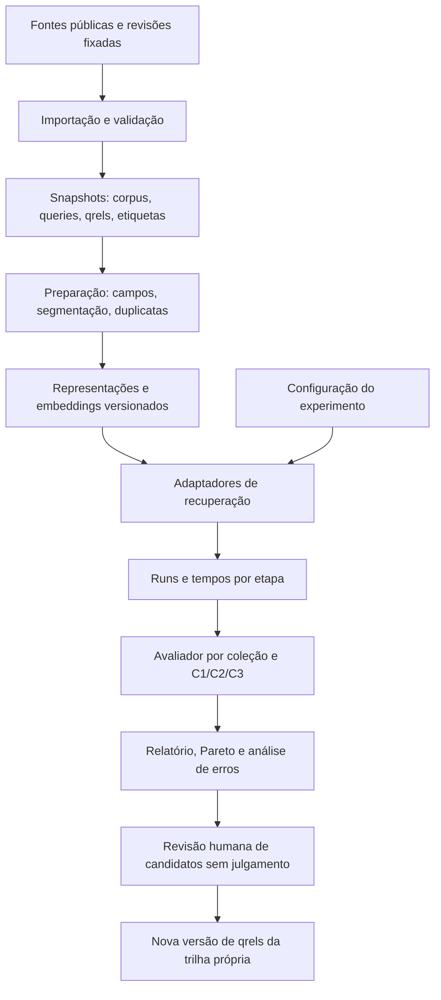

# LopsIR Benchmark — especificação da pesquisa e do hub de benchmarks

Estudo reprodutível de arquiteturas de recuperação de informação jurídica.

**Versão:** 0.1 — 29/10/2026. **Estado:** especificação e kit inicial; experimentos reais ainda não executados. **Repositório do projeto:** `lops-legal/lopsir-benchmark`.

**Atualização operacional de 29/10/2026:** o usuário determinou C1 → C2 → C3, cinco métodos publicados por caso e uso do acervo próprio de aproximadamente 370 mil jurisprudências reais. A localização desse acervo ainda precisa ser configurada. O [pipeline atual](docs/PIPELINE.md) prevalece sobre a ordem de execução e sugestões de importação deste SDD amplo. Não gerar dados fictícios nem importar novas coleções. As fixtures existentes são somente testes unitários históricos. As branches de trabalho são `c1`, `c2`, `c3` e `jua`.

SDD significa aqui desenvolvimento guiado por especificação: perguntas, contratos de dados, experimentos, critérios de aceitação e evidências precisam estar definidos antes da implementação dos adaptadores. A finalidade é encontrar arquiteturas adequadas a cada uso, sem escolher antecipadamente um banco ou um modelo vencedor.

## 1. Pergunta central e limites da pesquisa

**Quais combinações de recuperação, representação, índice e reranqueamento oferecem o melhor compromisso entre relevância jurídica, latência e custo para três tipos de consulta em português?**

Os três casos iniciais são:

| Caso | Necessidade | Exemplos ilustrativos | Resultado esperado |
|---|---|---|---|
| C1 — referência exata | Localizar um documento ou conjunto identificado | Número de processo; acórdão + ano + órgão; súmula + tribunal | Identidade correta e ausência de confusão entre referências |
| C2 — expressão jurídica | Encontrar decisões sobre uma expressão, tese ou trecho | `"novo e improrrogável prazo"`; termos jurídicos combinados; trecho literal | Resultados lexicais pertinentes, preservando frases e contexto |
| C3 — problema em linguagem natural | Encontrar fundamentos aplicáveis a fatos ou uma questão | Descrição de uma contratação, dúvida sobre requisitos ou relato de conflito | Recuperação semântica com pertinência fática e jurídica |

Esses casos são uma taxonomia do projeto. O JUÁ não publica uma classificação exatamente igual. Uma consulta pode ser mista; terá caso principal e etiquetas auxiliares, sem forçar uma classificação artificial. Uma referência mencionada dentro de uma pergunta pode ser pista de C3; só será C1 quando a intenção for localizar o item identificado.

Fase inicial: português brasileiro; busca com resultados e trechos verificáveis; três casos; coleções públicas com julgamentos de relevância; execução em uma máquina. Não vamos começar treinando um grande modelo, construindo um assistente que redige peças, nem comparando bases diferentes como se fossem o mesmo corpus.

Filtros por instituição, período e classe são dimensões transversais. Raciocínio entre múltiplos precedentes, atualização de entendimentos, busca de julgados semelhantes a uma peça e perguntas globais sobre o acervo ficam como extensões futuras. C3 já comporta descrições fáticas, mas não pressupõe resolver todo o raciocínio jurídico.

**Princípios:** resultado por caso e por coleção; controle de variáveis; nenhum escore sem proveniência; nenhuma extrapolação de milhares para bilhões sem medição; hipóteses podem ser rejeitadas; arXiv fundamenta candidatos e protocolos, e documentação oficial confirma capacidades de implementação. Estar no arXiv não equivale a comprovação independente ou consenso.

## 2. Glossário: o que será medido

| Termo | Explicação prática |
|---|---|
| Corpus | Coleção de documentos em que procuramos |
| Query | Consulta feita ao sistema |
| Qrels | Lista de pares consulta–documento avaliados, com grau de relevância |
| Run | Ranking produzido por um sistema para um conjunto fixo de consultas |
| Baseline | Referência simples e séria a ser superada, como BM25 ajustado |
| Embedding | Representação numérica usada para comparar consulta e documento |
| Dense / esparso | Vetor com muitos valores versus poucos valores não nulos |
| Bi-encoder | Codifica consulta e documento separadamente; permite pré-calcular documentos |
| Cross-encoder | Analisa o par consulta–documento conjuntamente; normalmente mais caro por candidato |
| Reranking | Reordenar candidatos; pode usar embeddings, cross-encoder ou outro modelo |
| ANN | Busca aproximada de vizinhos; troca alguma fidelidade ao ranking exato por recursos |
| k / @k | Quantas primeiras posições de uma lista estamos avaliando |
| Pareto | Configurações que nenhuma outra supera simultaneamente em todos os critérios considerados |

### 2.1 Recall@20, com um exemplo

Suponha uma consulta com **10 documentos relevantes conhecidos** nos qrels. Se o sistema traz **6 deles entre os primeiros 20**, então:

`Recall@20 = 6 / 10 = 0,60 = 60%`.

Isso não significa que 60% dos 20 resultados são corretos. Nesse exemplo, `Precision@20 = 6 / 20 = 30%`. Recall mede cobertura dos relevantes conhecidos; precisão mede a proporção de relevantes na lista apresentada.

Se há apenas um positivo conhecido e ele está na posição 17, Recall@20 e Hit@20 valem 1; MRR@20 vale `1/17`. Se o positivo está na posição 21, os três valem zero nesse corte. Recall@20 não distingue um acerto na primeira posição de outro na vigésima.

Se existem 100 relevantes, o Recall@20 máximo é 20%, mesmo com os 20 resultados perfeitos. Coleções com quantidade de positivos muito diferente não podem ser interpretadas por um único recall absoluto. Com julgamentos incompletos, chamaremos a medida de **recall sobre os positivos conhecidos**.

### 2.2 Métricas e convenções

| Métrica | Pergunta que responde | Uso principal |
|---|---|---|
| Hit@1 / Success@1 | O primeiro resultado pertence ao conjunto correto? | C1 |
| MRR@10 | Quão cedo aparece o primeiro relevante? Média de `1/posição`; zero se não aparece até 10 | C1; complemento de C2/C3 |
| Precision@10/20 | Qual fração da lista é relevante? | Experiência de leitura em C2/C3 |
| Recall@10/20/100/1000 | Qual fração dos positivos conhecidos foi encontrada? | Exibição e cobertura da geração de candidatos |
| nDCG@10/20 | Os documentos de maior relevância aparecem primeiro? | Métrica principal de ranking em C2/C3 |
| MAP@10 | Como se distribuem os acertos ao longo do ranking? | Compatibilidade e análise complementar |
| Judged@k | Quantos resultados do top-k foram efetivamente avaliados? | Diagnosticar incompletude dos qrels |
| ANN-recall@k | Quanto o índice aproximado recupera do top-k vetorial exato? | Engenharia do índice, separado da relevância jurídica |
| FilterViolation@k | Fração de resultados que viola filtros explícitos | Correção; alvo zero |
| p50/p95/p99 | Tempo abaixo do qual ficam 50%, 95% e 99% das requisições | Latência sob carga |
| QPS | Consultas concluídas por segundo, registrando falhas e fila | Capacidade |

Para a trilha própria: relevante binário = grau >= 1; nDCG usa ganho linear igual ao grau e desconto `log2(posição+1)`. Preservar grau original nos qrels. Rodar também sensibilidade a grau >= 2 quando fizer sentido. A trilha de reprodução deve usar exatamente o avaliador e as convenções originais, não presumir equivalência entre bibliotecas.

MAP@k possui variantes. No avaliador didático fornecido, AP@k divide a soma das precisões nas posições relevantes por `min(total de positivos, k)`; o nome de saída é `ap_at_k_minrel` para evitar confusão com outro MAP. Antes de publicar resultados oficiais, conferir concordância com um avaliador consolidado, por exemplo `ir_measures`/`trec_eval`, e registrar a medida exata.

Consultas sem positivo conhecido ficam fora das médias de relevância e aparecem em contagem separada. Consultas com positivo e sem resultados entram com zero. Ausência de julgamento é diferente de julgamento negativo: a convenção conservadora de computar não julgados como zero deve aparecer no relatório, junto com Judged@k e auditoria de novos positivos.

## 3. Leitura integral do JUÁ v2: o que aproveitar

Fonte principal: **JUÁ — A Benchmark for Information Retrieval in Brazilian Legal Text Collections**, arXiv:2604.06098v2, 08/04/2026. Foram lidas as 22 páginas do PDF fornecido, incluindo Tabela 2, Figuras 1–3, limitações e referências. [Texto no arXiv](https://arxiv.org/abs/2604.06098v2).

Hash SHA-256 do PDF lido: `9c5a7cda6a30a866c313d38982030c110c1a9b60c1dda145bc13179fe0286bf0`.

### 3.1 Estrutura metodológica

O trabalho reúne cinco coleções heterogêneas sob métricas e protocolo comuns, preservando resultados por coleção. Seu valor para nós é fornecer consultas, corpus e qrels reais, além de evidenciar que jurisprudência, normas, propostas legislativas e perguntas tributárias recompensam métodos diferentes.

| Coleção no artigo | Estrutura e escala reportada | O que aproveitar | O que não presumir |
|---|---|---|---|
| JUÁ-Juris | Enunciado como consulta e excerto correspondente como positivo; 1.714 consultas de teste, 10% da base descrita; qrels binários | Supervisão enunciado–fundamento e análise de dificuldade | Não são consultas reais de usuários; um positivo não esgota os precedentes relevantes |
| JurisTCU | Original com 16.045 documentos e 150 consultas; consultas reais e sintéticas; julgamentos inicialmente por LLM e verificados manualmente | C2/C3 e comparação lexical–semântica | A versão JUÁ usa só EXCERTO, sem ENUNCIADO; não acrescentar a ementa na trilha de reprodução |
| NormasTCU | Original com 14.469 documentos, 46 consultas e 812 pares julgados; graus de relevância | Robustez fora de jurisprudência e textos longos | Não mede diretamente todo o comportamento de busca judicial |
| Ulysses-RFCorpus | 692 consultas ligadas a pedidos legislativos; feedback de 54 consultores | Consultas operacionais e transferência institucional | Seu problema é legislativo; resultado não equivale a busca em acórdãos |
| BR-TaxQA-R / BR-TaxQA adaptado | 715 perguntas; resposta direta grau 2, respostas vinculadas grau 1 | C3 orientado a perguntas e relevância graduada | Respostas vinculadas não são todas igualmente relevantes |

Esses números vêm do artigo, não de uma contagem local dos arquivos. Repositórios podem mudar. Congelar revisão e contar corpus, consultas, qrels e graus antes do experimento.

### 3.2 Construção de dificuldade e splits

O texto descreve BM25 sobre enunciados, auto-recuperação de cada enunciado e uso de BM25_RANK para estratificar dificuldade; bins logarítmicos até 1024 e classe `not_found` fora do top-1000. O teste cobre estratos fáceis, médios e difíceis, com 90% restante para treino.

**Ponto a auditar:** auto-recuperar um texto idêntico tende a ser trivial, salvo duplicatas, tokenização ou outra diferença de representação. A descrição não esclarece completamente como a dificuldade semântica pretendida emerge dessa operação. Não reinterpretar silenciosamente o procedimento como consulta enunciado contra excerto. Reproduzir os arquivos oficiais e conferir o código de construção quando disponível. A direção e os limites exatos dos bins também devem vir do código.

Nossa extensão usará dificuldade medida sobre consulta e alvo efetivamente pesquisáveis, definida no desenvolvimento, com estratos por BM25 e por um modelo denso, além de uma amostra independente de consultas. Isso reduz a dependência de um único método indutor. Etiquetas de dificuldade servem à análise; não podem orientar ajustes com base no teste.

### 3.3 Métodos avaliados

O artigo compara BM25, embeddings Qwen 4B/8B, OpenAI 3-small, KaLM Gemma3 12B e variantes adaptadas Qwen 4B/0.6B. As variantes chamadas `Rerank` reordenam **top-1000 do BM25**. O texto não autoriza chamar todas essas variantes de cross-encoders; o detalhamento exato do scoring precisa ser conferido no código/model cards.

Treino reportado para Qwen3-Embedding-4B: 89.362 instâncias — JUÁ-Juris 27.690; Ulysses 42.580; Ulysses sintético 2.101; SQuAD-pt 16.991. Positivo por consulta, até cinco negativos; mineração sobre top-100 BM25; limiar `score > média + z(0,99) * desvio`, com alpha estatístico 0,01. O artigo descreve amostragem por dificuldade, remoção aproximada de consultas duplicadas e balanceamento. Os 27.690 exemplos de treino não devem ser confundidos com a quantidade de registros brutos inferida do split; é preciso conferir a transformação que gera instâncias.

Adaptação: InfoNCE, negativos em lote, LoRA rank 8, escala 32, `all-linear`, ms-swift; checkpoints a cada 100 passos, melhor em torno de 500 segundo critério combinado JUÁ + NormasTCU. A seleção usa desempenho de recuperação, não apenas loss. Para SQuAD-pt, seleção de pergunta representativa usa similaridades pergunta–passagem e pergunta–resposta com pesos 0,7/0,3.

**Aproveitar depois:** negativos difíceis, mistura jurídico + português geral, seleção por recuperação e teste de sobreespecialização. **Não adotar automaticamente:** cortes de score como prova de irrelevância, número de passos como receita universal ou uso de NormasTCU para escolher checkpoint e depois tratá-lo como teste externo intocado. O artigo não esclarece suficientemente a separação desse critério em dev/test. Nosso projeto exigirá essa separação.

### 3.4 Resultados que motivam, sem escolher vencedor

Na Tabela 2, BM25 obtém nDCG@10 de 0,362 em JurisTCU e 0,531 em Ulysses; Qwen 4B geral obtém 0,311 e 0,450. No BR-TaxQA, Qwen 8B obtém 0,799 versus 0,571 do BM25. Em JUÁ-Juris, Qwen 4B adaptado obtém 0,290 versus 0,199 do Qwen 4B geral. São referências publicadas, não resultados nossos.

Há arredondamentos e afirmações narrativas que precisam de leitura conjunta com a tabela: por exemplo, Qwen 4B adaptado aparece com 0,363 em JurisTCU, muito próximo dos 0,362 do BM25. Não transformar essa diferença em vitória robusta sem incerteza estatística.

Figuras 1–3 acrescentam MRR, MAP e Recall@10; a seção 5.5 analisa consultas em que lexical vence, denso vence ou ambos falham. Reproduziremos essa análise de desacordos. A média `Overall` do artigo é sobre datasets disponíveis; isso pode comparar coberturas diferentes. No hub, uma média comparativa só usará a mesma interseção de datasets e informará exclusões.

### 3.5 Extensões necessárias

| Limite da evidência | Decisão do projeto |
|---|---|
| JUÁ não é classificado nos nossos C1/C2/C3 | Criar etiquetas auditáveis e suíte adicional C1 |
| Treino alinhado a parte do benchmark | Marcar cada modelo como zero-shot, adaptado ou exposição desconhecida |
| qrels limitados ou derivados de um par | Medir cobertura dos julgamentos e julgar novos candidatos em trilha separada |
| Seleção de dificuldade dependente de BM25 | Manter estratos independentes e análise lexical + densa |
| Sem comparação completa de latência/custo por motor | Acrescentar trilha de sistemas com representações fixas |
| Coleções pequenas comparadas à web | Medir escalabilidade progressiva, sem chamar benchmark local de prova em bilhões |
| Temas concentrados em TCU e setor público | Acrescentar mais tarde amostra judicial de outros tribunais com qrels próprios |

## 4. Não misturar modelos, motores e armazenamento

`pgvector versus BM25 versus BERT versus Parquet` mistura níveis diferentes. Vamos comparar arquiteturas por componentes:

| Camada | Exemplos | Variável estudada |
|---|---|---|
| Representação/scoring | BM25, SPLADE, embedding, ColBERT | Como a relevância é estimada |
| Modelo | Qwen, BGE, encoder BERT, reranqueador | Pesos, treino, idiomas e custo de inferência |
| Índice | Invertido, HNSW, IVF/PQ, busca exata | Como candidatos são localizados |
| Motor | Manticore, Lucene/OpenSearch, PostgreSQL + pgvector, Faiss | Execução, filtros, atualização e recursos |
| Dados analíticos | Parquet + DuckDB; opcional Iceberg | Snapshots, transformação, análise e reprodução |
| Pipeline | Roteamento, expansão, fusão, reranqueamento | Composição e orçamento por consulta |

BERT é uma família de modelos, não um banco nem um método completo. Registrar checkpoint, papel (bi-encoder/cross-encoder), pooling, prefixos e truncamento. PostgreSQL FTS não será chamado de BM25 sem implementar e identificar uma extensão ou pontuação apropriada.

### 4.1 Três trilhas de comparação

**A — qualidade dos métodos:** mesmo snapshot, consultas, qrels e unidade de avaliação. Para vetores, iniciar com scoring exato nos corpora que couberem, para isolar a qualidade do modelo do erro ANN. Para BM25 entre implementações, declarar análise linguística, fórmula e diferenças.

**B — eficiência dos motores:** reutilizar exatamente os mesmos embeddings, IDs, texto, filtros, hardware e top-k. Comparar exato, pgvector HNSW/IVFFlat e Faiss; comparar motores lexicais com tokenização tão equivalente quanto possível. Avaliar ANN-recall em relação ao exato. Comparações com rankers/tokenização diferentes serão rotuladas como comparação de sistemas completos, não apenas de motores.

**C — arquiteturas completas:** medir a experiência final incluindo codificação da consulta, filtros, fusão, fetch, reranking e serialização. Comparar roteamento fixo e adaptativo. O resultado é uma fronteira de qualidade–latência–custo para cada caso.

Parquet/Iceberg não será colocado como concorrente de BM25: é a base dos dados que alimentam os índices. Um experimento independente medirá tempo de ingestão, leitura, manutenção e reprodutibilidade com e sem Iceberg.

## 5. Arquitetura especificada para o hub



### 5.1 Núcleo e interfaces

Uma CLI Python orquestra experimentos; um relatório HTML ou notebook exibe comparações. A interface visual vem após existir uma execução reproduzível. Python é a camada comum; motores nativos entram por adaptadores. DuckDB lê Parquet e resultados. Um manifesto de arquivos com hashes dá snapshots imutáveis no MVP. Iceberg é uma evolução a testar, não pré-requisito.

Interfaces previstas:

```python
class Retriever:
    def build(self, corpus_snapshot, representation, config): ...
    def search(self, query_text, filters, top_k): ...  # ranked hits + timings
    def capabilities(self): ...  # exact, filters, sparse, updates, limits

class Encoder:
    def encode_documents(self, texts, config): ...
    def encode_queries(self, texts, config): ...

class Reranker:
    def score(self, query_text, candidate_texts, config): ...
```

Todo adaptador informa recursos não suportados; não deve substituir silenciosamente filtro, distância, dimensão ou modelo. Falha, timeout e OOM viram estados da execução, nunca resultados descartados da média de desempenho.

### 5.2 Pipeline de consulta

1. Preservar texto original; extrair referências e filtros explícitos por regras auditáveis.
2. Roteamento: C1 usa campo exato; C2 usa lexical; C3 usa lexical + denso. Isso é uma baseline de roteamento a testar, não arquitetura vencedora presumida.
3. Rodar também alternativas puras e híbridas em todos os casos elegíveis para verificar o benefício do roteamento.
4. Aplicar filtros nos caminhos de recuperação; se o motor fizer pós-filtro, registrar overfetch e resultados faltantes.
5. Fundir listas e remover duplicatas de ID; para decisões fragmentadas, limitar trechos por decisão e declarar a agregação.
6. Reranquear somente a lista configurada. Busca por identidade pode dispensar inferência.
7. Retornar ID, ranking, trecho literal, fonte e metadados. Distinguir referência citada de documento-alvo.

Não aplicar stemming ou expansão a números identificadores. Preservar negações, datas, unidades e referências legais na análise textual; comparar normalização de acentos e variantes sem destruir campos exatos.

### 5.3 Requisitos verificáveis

| ID | Requisito | Aceitação |
|---|---|---|
| R01 | Classificação C1/C2/C3 e etiquetas mistas | Todas as consultas do relatório têm origem e regra de classificação |
| R02 | Importação em esquema comum | IDs e relações válidos; nenhuma linha perdida silenciosamente |
| R03 | Reexecução por manifesto | Mesmos hashes de corpus/config; divergência numérica tolerada e registrada |
| R04 | Separar método e motor | Trilha e variáveis controladas constam do experimento |
| R05 | Medir relevância por corte | @10 para JUÁ; @20 e profundidades maiores na extensão |
| R06 | Medir custo e tempo por estágio | Latência total e de etapas; ingestão separada de consulta |
| R07 | Rastrear exposição a dados | Modelo com treino conhecido, desconhecido ou controlado |
| R08 | Filtros corretos | Testes de casos positivos/negativos; zero violações observadas |
| R09 | Executar no orçamento da máquina | Pré-cálculo de memória/disco; serviço isolado; OOM registrado |
| R10 | Publicar evidência, não só média | Resultados por consulta/caso/dataset e limitações |

## 6. Dados reais, classificação e qrels

### 6.1 Três placares separados

**JUÁ-native:** reproduz as cinco coleções e métricas oficiais, preservando campos, splits e qrels. Etiquetas C2/C3 são uma análise adicional; não modificam os rankings ou os julgamentos. Não inventar C1 em uma coleção que não o contém.

**LopsIR-Cases:** extensão nossa, com os três casos. C1 nasce de referências inequívocas em metadados de documentos reais; C2/C3 usam consultas existentes classificadas e consultas de usuários/profissionais a coletar. Reformulações e consultas sintéticas têm rótulo de origem e resultados separados. Objetivo inicial: 100 C1, 100 C2 e 100 C3 no teste próprio, quando houver julgamentos suficientes. É uma meta de coleta, não quantidade já disponível.

**Scale/Systems:** mede motores, ingestão e ANN em snapshots crescentes. Um corpus ampliado sem novos qrels mede cobertura dos positivos originais e desempenho técnico, não relevância exaustiva em toda a nova coleção.

### 6.2 Fontes e prioridades

| Fonte | Uso | Prioridade |
|---|---|---|
| [JUÁ-Juris](https://huggingface.co/datasets/ufca-llms/jua) | Pareamento enunciado–excerto; adaptação e análise de dificuldade | Inicial, se o artefato estiver acessível |
| [JurisTCU adaptado](https://huggingface.co/datasets/ufca-llms/juris-tcu) | Jurisprudência C2/C3 | Inicial |
| [BR-TaxQA](https://huggingface.co/datasets/ufca-llms/BR-TaxQA) | C3 e teste rápido de integração | Inicial |
| [NormasTCU](https://huggingface.co/datasets/ufca-llms/normas-tcu) | Transferência e textos longos | Segunda rodada |
| [Ulysses](https://huggingface.co/datasets/ufca-llms/Ulysses-RFCorpus) | Linguagem operacional, C2/C3 | Segunda rodada |
| [Quati, arXiv:2404.06976](https://arxiv.org/abs/2404.06976) | Português geral e perda de generalização | Controle externo |
| [CLERC, arXiv:2406.17186](https://arxiv.org/abs/2406.17186) | Recuperação a partir de análise e citações | Extensão internacional separada |
| [LeCaRDv2, arXiv:2310.17609](https://arxiv.org/abs/2310.17609) | Similaridade entre casos em chinês | Extensão; não agregar ao placar brasileiro |

Os endpoints Hugging Face de JurisTCU, BR-TaxQA e Ulysses foram inspecionados na web; arquivos não foram baixados. O endpoint de JUÁ-Juris não ficou acessível pela ferramenta consultada. A licença, revisão, completude dos splits e tamanho dos arquivos ainda precisam de verificação na ingestão. Se um recurso falhar, registrar ausência; não substituir por outro e manter o nome original.

Nas páginas consultadas, JurisTCU usa `query-id/corpus-id` e graus 0–3; BR-TaxQA usa `query_id/corpus_id` e graus 1–2. Essa diferença exemplifica por que os importadores devem mapear explicitamente nomes e escalas, preservando os valores originais. Contagens de linhas de qrels não são contagens de consultas nem de documentos.

### 6.3 Regras de classificação

Classificar intenção, não somente tamanho ou presença de interrogação. Dois anotadores classificam uma amostra, conciliam divergências e congelam um guia. O classificador automático, se criado depois, é avaliado contra esse conjunto. Relatar concordância e matriz de confusão. Consultas ambíguas ficam `mixed` ou `unclassified` até revisão.

Etiquetas auxiliares: literal/frase, referência citada, negação, descrição fática, filtro temporal, instituição, tipo documental, linguagem leiga/técnica, real/sintética, tamanho e dificuldade. O caso é informado pelo conjunto de avaliação, não predito a partir de qual sistema acertou.

### 6.4 Construção da suíte C1

Usar somente documentos com metadados públicos inequívocos. TCU permite referências do próprio tribunal quando disponíveis; isso não autoriza inventar CNJ. Identidade composta pode exigir órgão, ano e colegiado. Referências a súmulas/temas exigem coleção correspondente; não existem automaticamente dentro do corpus JUÁ.

Gerar variantes controladas de pontuação, caixa e abreviação; separar variantes de digitação incorreta. Criar negativos com mesmo número e outro ano/órgão. Se a referência for legitimamente ambígua, aceitar o conjunto elegível ou exigir esclarecimento; não escolher um positivo arbitrário. Distinguir localizar um acórdão de localizar todos os documentos que o citam.

Consultas derivadas de metadados são uma suíte de identidade, com origem derivada declarada. Não apresentar seu resultado como comportamento real de usuários. Agrupar variantes do mesmo alvo no mesmo split e na reamostragem estatística.

### 6.5 Relevância jurídica da suíte própria

Grau 0: não atende; grau 1: útil de modo secundário; grau 2: atende bem; grau 3: fundamento diretamente pertinente aos elementos materiais da consulta. Anotadores recebem critérios e contexto da pergunta. Conclusão favorável ao usuário só é requisito se a pergunta pedir isso; precedentes contrários podem ser relevantes e devem ser identificados.

Etiquetas de erro: assunto próximo com fatos diferentes; tese rejeitada tratada como adotada; argumento da parte confundido com fundamento; divergência confundida com resultado; referência apenas citada; versão temporal inadequada; fragmento sem contexto; identidade errada. Alegar superação ou força vinculante exige fonte e julgamento específicos; similaridade não determina essas propriedades.

Para expandir julgamentos: pooling de top-20 de famílias lexical, densa, esparsa e multivetorial, embaralhado e sem identificação do sistema; incluir amostra aleatória e candidatos exclusivos. Dois avaliadores jurídicos nas consultas críticas, conciliação e rastreio de alterações. Qrels originais nunca são sobrescritos. Julgamento por LLM é auxiliar identificado; não substitui silenciosamente especialista.

### 6.6 Separação e contaminação

Preservar splits oficiais na reprodução. Na extensão, usar 60/20/20 treino/dev/test por grupos de decisão, referências e duplicatas, congelados antes do ajuste; considerar separação temporal e por instituição quando houver dados. Reformulações da mesma consulta ficam no mesmo grupo. Acesso a corpus de teste para indexar é necessário; usar consultas/qrels de teste para treinar ou selecionar hiperparâmetros não é permitido no teste intocado.

Comparar checkpoints publicados com declaração de exposição; desempenho em benchmark possivelmente conhecido pelo modelo é distinto de generalização. `out-of-domain` deve significar domínio fora do treino, e `held-out test` significa fora de qualquer seleção: são propriedades diferentes.

## 7. Portfólio de candidatos e fundamento científico

A ordem de entrada considera valor experimental e viabilidade. SOTA é sempre qualificado por tarefa, data e custo; modelos de ponta gerais não são automaticamente de ponta no jurídico brasileiro.

| Família | Candidato e motivo | Evidência principal | Entrada |
|---|---|---|---|
| Lexical | BM25 ajustado; exato; frases e campos | Baseline robusta no JUÁ e BEIR | P0 |
| Expansão de consulta | Dicionário jurídico e Query2doc | [Query2doc, 2303.07678](https://arxiv.org/abs/2303.07678): geração de pseudodocumentos para reduzir desencontro lexical | P1 |
| Expansão documental | doc2query | [1904.08375](https://arxiv.org/abs/1904.08375): consultas previstas antes da indexação | P1 |
| Denso | Pequeno multilíngue versus maior e adaptado | [Qwen3, 2506.05176](https://arxiv.org/abs/2506.05176); JUÁ; [adaptação brasileira, 2605.04005](https://arxiv.org/abs/2605.04005) | P0/P1 |
| Representação unificada | BGE-M3 | [2402.03216](https://arxiv.org/abs/2402.03216): denso, esparso e multivetorial no mesmo modelo | P1 |
| Híbrido | BM25+denso; depois SPLADE+denso | [Fusão, 2210.11934](https://arxiv.org/abs/2210.11934): comparar RRF com combinação de scores ajustada | P0/P1 |
| Esparso aprendido | SPLADE-v3 + invertido / Seismic | [2403.06789](https://arxiv.org/abs/2403.06789); [escala esparsa, 2501.11628](https://arxiv.org/abs/2501.11628) | P1/P2 |
| Interação tardia | ColBERTv2/LateOn; PLAID/WARP como motores | [2112.01488](https://arxiv.org/abs/2112.01488), [2205.09707](https://arxiv.org/abs/2205.09707), [2501.17788](https://arxiv.org/abs/2501.17788), [2607.27178](https://arxiv.org/abs/2607.27178) | P2 |
| Multivetorial aproximado | MUVERA | [2405.19504](https://arxiv.org/abs/2405.19504): aproxima interação multivetorial por codificações fixas | P2 |
| Reranking | Similaridade de embeddings sobre candidatos; cross-encoder pequeno; LLM como teto experimental | JUÁ; [RankZephyr, 2312.02724](https://arxiv.org/abs/2312.02724); [reprodução de PLAID, 2404.14989](https://arxiv.org/abs/2404.14989) | P0/P1/P2 |
| Compactação | Matryoshka e quantização | [2205.13147](https://arxiv.org/abs/2205.13147): representações progressivas, quando o modelo for treinado para isso | P1 |
| ANN em escala | HNSW, Faiss IVF/PQ, DiskANN/FreshDiskANN | [1603.09320](https://arxiv.org/abs/1603.09320), [1702.08734](https://arxiv.org/abs/1702.08734), [2205.03763](https://arxiv.org/abs/2205.03763), [2105.09613](https://arxiv.org/abs/2105.09613) | P1/P2 |
| Busca filtrada | Estratégias prefilter/postfilter; ACORN quando disponível | [2403.04871](https://arxiv.org/abs/2403.04871): busca vetorial com predicados estruturados | P1/P2 |
| Contexto de documentos | Embeddings contextualizados | [pplx-embed, 2602.11151](https://arxiv.org/abs/2602.11151) | P1 |

**Fronteira exploratória, fora do primeiro ciclo:** recuperação generativa ([2509.22116](https://arxiv.org/abs/2509.22116), [2504.17519](https://arxiv.org/abs/2504.17519)), RAPTOR ([2401.18059](https://arxiv.org/abs/2401.18059)) e GraphRAG ([2404.16130](https://arxiv.org/abs/2404.16130)). São perguntas de pesquisa diferentes, com custos de construção e atualização que precisam de avaliação específica. Não serão requisito do MVP.

**Escala e atualização de evidência:** [Q2D-Web, 2609.08887](https://arxiv.org/abs/2609.08887) testa cerca de 190M documentos e mostra que métrica, idioma e tipo de consulta mudam a ordenação dos modelos; não é benchmark jurídico. [Avaliação multidomínio, 2609.29455](https://arxiv.org/abs/2609.29455) reforça comparar qualidade e tempo. [Hierarchical BM25, 2608.00229](https://arxiv.org/abs/2608.00229) fica experimental porque o próprio texto deixa recall em bilhões e comparação com BlockMax-WAND em aberto.

BEIR ([2104.08663](https://arxiv.org/abs/2104.08663)) fundamenta avaliação heterogênea; BRIGHT ([2407.12883](https://arxiv.org/abs/2407.12883)) e o benchmark jurídico de raciocínio ([2505.03970](https://arxiv.org/abs/2505.03970)) lembram que similaridade não resolve todo raciocínio de relevância. Esses trabalhos orientam análise de falhas, não transferem seus scores ao nosso corpus.

## 8. Hipóteses pré-registradas

Hipóteses abaixo são propostas a testar. Para todas: ajustar somente em dev; comparar os mesmos queries/corpus; publicar por dataset e caso; usar intervalos de confiança pareados por grupo; registrar falhas e exceções. O limiar padrão de ganho prático sugerido é +0,02 absoluto de nDCG, não +2% relativo; pode ser revisto antes de abrir o teste.

| ID | Hipótese | Experimento e condição de apoio |
|---|---|---|
| H1 | C1 é resolvido com menor custo por índice exato normalizado | Comparar exato, BM25 e denso; exato deve manter Hit@1 >= 0,99 na suíte inequívoca e consumir menos latência/custo; reportar variantes ambíguas separadamente |
| H2 | BM25 ajustado é difícil de superar em C2 com forte ancoragem lexical | Comparar BM25, denso e híbrido; verificar não inferioridade de nDCG com margem 0,01 e redução de custo, sem generalizar a todo C2 |
| H3 | Híbrido aumenta cobertura em C3 | Comparar recall@100 do conjunto unido e nDCG@10; apoio se houver ganho de cobertura e ganho prático de ranking, dentro do orçamento |
| H4 | Reranqueamento curto oferece ganho melhor por custo que ampliar muito o embedding | Pequeno + rerank versus grande sem rerank; mesmas consultas e custo total; procurar dominância/Pareto, não vitória em score isolado |
| H5 | Expansão jurídica controlada ajuda C2 com baixo custo | Dicionário versionado versus consulta original; medir ganhos e query drift, preservando identidade C1 |
| H6 | Expansão documental pode trocar ingestão maior por consulta econômica | doc2query versus BM25; incluir bytes, tempo de construção e amortização para diferentes volumes de consulta |
| H7 | SPLADE pode entrar na fronteira de qualidade/custo do jurídico | SPLADE versus BM25 e denso; medir inferência + recuperação; Seismic entra em comparação de índice separada |
| H8 | Segmentação jurídica preserva pertinência com menos vetores | Ementa; excerto; inteiro teor segmentado; ementa+fundamentos; mesmo orçamento de candidatos e avaliação no nível da decisão |
| H9 | Redução de dimensão/quantização economiza com pequena perda | Representações compatíveis; apoio se perda nDCG <= 0,01, redução mensurada de bytes e benefício de latência/custo; verificar ANN-recall |
| H10 | Adaptação exclusivamente jurídica pode perder generalização | Base versus adaptado jurídico versus misto; teste externo intocado e por instituição; não selecionar checkpoint no teste externo |
| H11 | Fusão ajustada pode superar RRF | Mesmos candidatos; ajuste do peso em dev; apoio se ganho nDCG >= 0,01 no teste, com incerteza reportada |
| H12 | Roteamento por caso reduz custo mantendo relevância | Router versus híbrido sempre; margem de não inferioridade 0,01 e redução de custo/latência; incluir erros do router |
| H13 | Motores diferentes divergem em custo mesmo com os mesmos vetores | pgvector versus Faiss; fidelidade ANN >= 0,95 e >= 0,99 em curvas separadas; recursos iguais e qualidade jurídica verificada |
| H14 | Filtros seletivos alteram recall e latência | 100%, 10%, 1%, 0,1% elegíveis, com e sem correlação semântica; zero violações e comparação contra exato filtrado |
| H15 | Multivetorial ajuda consultas que dependem de detalhes | Comparar com denso e híbrido; resultado por etiquetas de fatos/negação; incorporar armazenamento e inferência |
| H16 | Iceberg compensa quando há evolução e múltiplos snapshots, não necessariamente no MVP local | Parquet+manifesto versus Iceberg sobre mesmos dados; ingestão, leitura, manutenção e consistência; qualidade de busca invariável com snapshot igual |

Resultados inconclusivos por amostra pequena não contam como confirmação. Alegação de não inferioridade exige intervalo compatível com a margem; `p > 0,05` sozinho não demonstra equivalência.

## 9. Parâmetros: reprodução primeiro, exploração controlada depois

Legenda: **P** = configuração ou procedimento reportado no paper; **D** = capacidade verificada na documentação do motor; **E** = grade exploratória proposta por nós. Não apresentar uma grade E como parâmetro testado em um artigo.

| Família | Reprodução / referência | Grade inicial E, ajustada ao orçamento |
|---|---|---|
| BM25 | JUÁ usa BM25; k1, b e analisador não estão suficientemente especificados no PDF | k1: 0,6 / 1,2 / 1,8; b: 0,2 / 0,75 / 1,0; 9 combinações por analisador, só dev |
| Tokenização | Preservar termos e referências; variante de cada motor explicitada | Acentos; stemming ligado/desligado; campo exato; frases; mesmos campos |
| Expansão | Doc2query/Query2doc fornecem os procedimentos, não um ganho garantido local | 0/5/10 termos; peso original fixado; 0/5/10 consultas por documento em amostra; sem geração no teste para escolher prompts |
| Híbrido | P: RRF versus combinação convexa normalizada | RRF c: 10/60/100; profundidades por ramo: 50/100/200/1000; peso lexical: 0/0,25/0,5/0,75/1 |
| Rerank | P JUÁ: top-1000 BM25 | 0/20/50/100/200; 1000 apenas como reprodução separada; embeddings e cross-encoder em linhas diferentes |
| Segmentação | P JurisTCU adaptado: EXCERTO; NormasTCU: ASSUNTO + TEXTONORMA | Estrutural e janelas de 256/512/1024 tokens; sobreposição 0/15%; manter offsets e parent ID |
| Denso | P: famílias Qwen e adaptação; prefixos/instruções do checkpoint | Modelo pequeno/maior; dimensão nativa e dimensões reduzidas suportadas; float32/float16; int8 só quando implementado e validado |
| HNSW | D: M, ef_construction, ef_search disponíveis nos motores compatíveis | M: 16/32; construção: 100/200; busca: 40/100/200/400; orçamento igual e recall contra exato |
| IVFFlat | D pgvector: lists/probes, índice requer treino sobre dados | lists em torno de sqrt(N) apenas como heurística inicial; probes: 1/4/16/64, limitado a lists; registrar número real |
| IVF/PQ | P Faiss: busca comprimida; precisa treino representativo | nlist por escala; nprobe; 8 bits e m compatível com dimensão; selecionar em dev por fidelidade e memória |
| SPLADE/Seismic | P 2501.11628: lambda 3e4–9e4; energia 0,4; blocos lambda/10; cut 2–14; heap_factor 0,6–1; kappa 10/20; HNSW M 16/32/64 e efc 500 | Não copiar esses tamanhos para corpus minúsculo; limitar por tamanho das listas e orçamento; medir versão sem grafo e com grafo separadamente |
| LoRA posterior | P JUÁ: r=8, escala=32, all-linear, até 5 negativos, top-100 e checkpoints/100 passos | Sem treino no MVP; depois reproduzir em modelo que caiba, ajustando batch/sequência e declarando desvio |
| Filtros/carga | D: recursos por adaptador; P ACORN motiva filtros | Seletividades acima; concorrência 1/2/4/8; batch separado; atualização 0/1/5% por ciclo |

Usar busca em estágios, não produto cartesiano de toda a tabela. Primeiro parâmetros padrão documentados e baseline; depois no máximo 12–20 configurações por família/coleção no dev, com três sementes quando houver aleatoriedade. Guardar histórico de todas as tentativas para expor custo do tuning. Selecionar finalistas por qualidade e recursos, então abrir teste uma vez.

Na escala esparsa, o paper mede aproximadamente 3 ms e 98% de fidelidade a vizinhos em uma configuração de 138M passagens, sem codificação da consulta. Não usar esse número como SLO do hub ou como 98% de relevância jurídica. Ganhos de WARP/PLAID também pertencem às implementações e condições dos respectivos artigos.

## 10. Modelos, OpenRouter e execução local — seção única operacional

### 10.1 Hardware e situação verificada

Em 29/10/2026, leitura via `nvidia-smi`: **NVIDIA GeForce GTX 1650, 4096 MiB**, driver 596.49. Python identifica 12 processadores lógicos. O diagnóstico do kit confirmou aproximadamente **7,84 GiB de RAM física** (classe comercial de 8 GB), com apenas **0,46 GiB disponível** naquele instante, e cerca de 351 GiB livres no volume C. Memória disponível é dinâmica. O modelo comercial exato da CPU permanece não identificado; a assinatura disponível está no relatório de ambiente.

No runtime de documentos inspecionado, PyTorch, Transformers, SentenceTransformers, DuckDB e PyArrow não estavam instalados. Docker não foi localizado no PATH; a consulta de WSL não confirmou um ambiente utilizável. Isso é um diagnóstico parcial, não prova de ausência em toda a máquina. Criar ambiente próprio do projeto; não instalar bibliotecas de pesquisa no runtime interno do aplicativo.

### 10.2 Política de execução

**Local:** baselines exatas/lexicais em CPU; um modelo pequeno por vez; batch 1 inicialmente; sequência limitada e memória medida antes de aumentar. Qwen3-Embedding-0.6B é candidato, não promessa de caber com qualquer contexto. Float16/CUDA e kernels precisam ser testados nesta GPU; se houver incompatibilidade, usar CPU ou backend compatível e registrar. Pesos de 0,6B em FP16 já representam cerca de 1,2 GB, sem ativações/framework; 4B em FP16 excede a VRAM observada antes mesmo dessas parcelas.

Com a RAM observada, começar em BR-TaxQA e em amostra de desenvolvimento de até 10k documentos. O teste oficial deve depois usar o corpus integral correspondente, sem apresentar a amostra como reprodução. Planejar processamento em streaming, vetores em disco e nenhum conjunto de vários bancos simultâneos. Antes de cada rodada, medir memória livre; reservar margem para o SO e exigir recursos estimados de índice/modelo mais margem antes de iniciar. Com menos de 1 GiB livre, permanecer no diagnóstico/fixture ou liberar recursos antes de testes pesados. Iceberg, OpenSearch e modelos maiores são perfis opcionais sujeitos ao pré-cálculo, não serviços permanentes nesta máquina.

**OpenRouter:** embeddings maiores e alternativas comerciais por API, com catálogo e provedor fixados quando possível. [GET /embeddings/models](https://openrouter.ai/docs/api/api-reference/embeddings/list-embeddings-models) descobre modelos e preços; [POST /embeddings](https://openrouter.ai/docs/api/api-reference/embeddings/submit-an-embedding-request) gera vetores. Validar disponibilidade e dimensões na data da execução. Não presumir que um endpoint genérico de embeddings retorna saídas esparsas ou multivetoriais de BGE-M3: essas funcionalidades precisam de endpoint específico ou execução local.

Candidatos de triagem: Qwen3 pequeno local; Qwen3 maior remoto; BGE-M3 denso; um embedding comercial econômico; modelo jurídico adaptado se pesos/revisão estiverem publicados. Modelos sem versão verificável terão reprodução limitada explicitamente marcada. Não misturar vetores de modelos, versões ou dimensões diferentes no mesmo índice.

Reranking remoto é opcional e depende de API/score apropriado verificado; não enviar uma solicitação de embedding esperando comportamento de cross-encoder. Não haverá chamadas pagas no kit inicial. Antes de gerar um corpus inteiro, executar amostra, estimar tokens/bytes/custo e definir limite financeiro no manifesto.

### 10.3 Controles de custo, cache e comparabilidade

Credencial em variável `OPENROUTER_API_KEY`, nunca em config versionada. Não registrar cabeçalhos nem chave. Fixar modelo, provedor, input_type/instrução, dimensões, normalização e versão; se o backend trocar silenciosamente, marcar a execução como não comparável. Respeitar políticas de processamento de dados do endpoint; utilizar textos públicos permitidos.

Chave de cache: hash do texto + hash de preparação + modelo/revisão/provedor + dimensão + instrução + normalização. Armazenar vetores uma vez por configuração e reutilizar entre motores. Cache de documentos é normal; cache da consulta é uma modalidade de medição separada.

Registrar separadamente: ingestão/embeddings do corpus; codificação da consulta; rede/fila/retries; recuperação; reranking. Reportar dois tempos: **vetores prontos**, para comparar índices, e **ponta a ponta**, para comparar serviço real. API remota pode ser barata em tokens e lenta por rede; computação local tem custo de energia, ocupação e hardware, não custo zero.

`custo mensal estimado = ingestão amortizada + consultas + armazenamento + operação/hardware`.

Para experimentos locais, apresentar primeiro recursos físicos e tempo; estimar moeda com tarifa e amortização declaradas. Sem preço fixo inventado para API. O comparador deve conservar o catálogo/preço usado na data, tokens faturados quando disponíveis e custo das tentativas falhas. Orçamento sugerido de uma rodada exploratória só será fixado após medir a amostra.

### 10.4 Ambiente isolado e serviços

Python 3.11 ou 3.12 em `.venv`, com lockfile do gerenciador escolhido. Dependências por extras: `data` (datasets, pyarrow, duckdb), `eval` (ir_measures), `local-models` (torch, transformers, sentence-transformers), `engines` (clientes), `report` (pandas/plotagem). Versões e hashes precisam ser fixados no bootstrap real; não fornecer um lockfile fictício.

Executar inicialmente CPU/exato e um serviço por vez. Motores Linux podem usar WSL2/container quando disponíveis; instalação/configuração será uma tarefa específica. Faiss, Seismic e motores multivetoriais exigem verificar suporte Windows/Linux e disponibilidade de wheels. Não tornar esses componentes obrigatórios para abrir o projeto.

O kit atual fornece `doctor.py` e `evaluate.py`, ambos de biblioteca padrão, sem serviços externos. O manifesto de exemplo é plano de experimento; não provisiona PostgreSQL, Manticore nem modelos. A implementação dos adaptadores consta do backlog. Isso mantém a preparação auditável sem confundir documentação com infraestrutura já instalada.

## 11. Armazenamento e motores candidatos

| Opção | Papel no estudo | Primeiro experimento |
|---|---|---|
| Parquet + DuckDB + manifesto | Dados e análise local; baseline de baixo esforço operacional | Importar snapshots e consultar resultados |
| Apache Iceberg sobre Parquet | Catálogo/snapshots e evolução transacional de tabelas | Mesmo corpus, operações de atualização e recuperação de snapshots |
| Manticore | Busca lexical, filtros e ranking configurável | BM25 documentado e ranker explícito; sem assumir superioridade |
| Lucene/Anserini ou OpenSearch | Referência lexical e alternativa de sistema completo | Análise linguística comparável; escolher uma interface inicial |
| PostgreSQL + pgvector | Exato e ANN com metadados/SQL | Mesmos vetores: exato → HNSW → IVFFlat |
| Faiss | Controle de busca vetorial e compressão | Exato → HNSW/IVF; implementação compatível com ambiente |
| Seismic / PLAID / WARP | Motores especializados | Somente após baselines e preparação de representações |

Fontes de implementação: [pgvector](https://github.com/pgvector/pgvector), [ranking Manticore](https://manual.manticoresearch.com/Searching/Sorting_and_ranking), [OpenSearch híbrido](https://docs.opensearch.org/latest/vector-search/ai-search/hybrid-search/index/), [Iceberg spec](https://iceberg.apache.org/spec/), [DuckDB Parquet](https://duckdb.org/docs/stable/data/parquet/overview).

O Manticore possui opções de ranking que combinam fatores; não chamar o default de BM25 puro sem conferir a expressão escolhida. No pgvector, distância, normalização, tipo e limites dimensionais precisam ser compatíveis com o embedding; definir a representação antes do índice. Iceberg tem custos de catálogo/metadata/compactação a medir. Um scan Parquet é controle de leitura ou scoring exato implementado, não um índice textual gratuito.

## 12. Contratos de dados e resultados

Formato canônico para MVP: JSONL/TSV, depois Parquet com o mesmo esquema lógico. Strings para IDs; nenhuma conversão que apague zeros ou misture instituições.

```text
corpus: dataset_id, snapshot_id, doc_id, parent_id?, text, title?, fields_json,
        court?, decision_date?, publication_date?, source_uri?, content_sha256
queries: query_id, text, case_type, origin, language, group_id, split,
         filters_json, labels_json, annotation_version
qrels: query_id, doc_id, relevance, source, judgment_version
run: experiment_id, query_id, doc_id, rank, score
timings: experiment_id, query_id, repetition, queue_ms, encode_ms, network_ms,
         retrieve_ms, fuse_ms, fetch_ms, rerank_ms, total_ms, status
resources: experiment_id, peak_rss_bytes, peak_vram_bytes, index_bytes,
           build_seconds, embedding_seconds, updates_per_second
```

Preservar offsets e hash do texto original quando houver trechos; metadados ausentes são nulos, nunca inferências apresentadas como fatos. Qrels podem conter zeros e positivos; positivos devem existir no corpus. Embeddings guardam shape/dtype e a sequência de IDs, para evitar desalinhamento após ordenação de arquivos.

Manifesto do experimento contém: ID, data, commit, trilha, pergunta/H, snapshot e hashes; revisão do modelo; configuração de texto; motor e build; biblioteca de métricas e convenções; corpus/queries/qrels por split; sementes; parâmetros; cache; recursos; limites; custo; status; arquivos de saída. Hash do manifesto entra nos resultados. O manifesto de exemplo distribuído é deliberadamente `planned` e sem revisões fingidas.

Avaliar no nível original de cada coleção. Se um motor recupera passagens e o qrel é de decisão, colapsar para parent antes do top-k final, com regra fixa (por exemplo máximo score, depois regra de desempate); não multiplicar acertos por fragmentos do mesmo pai. Fusão deve operar no nível declarado.

## 13. Protocolo de medição e estatística

1. Validar corpus/queries/qrels e documentar campos, licenças, revisões e exclusões.
2. Congelar treino/dev/test e grupos; registrar exposição dos modelos.
3. Rodar baseline aleatória, exata C1 e BM25; conferir manualmente exemplos e métricas.
4. Ajustar em dev com orçamento de busca equivalente por família; separar default de tuned.
5. Gerar rankings até 1000 quando o corpus permitir; métricas @10/@20 e recall em profundidade. Top-k de candidatos é diferente do corte de avaliação.
6. Testar finalistas em ordem aleatória, um motor por vez, com dados e CPU/threads fixos. Três repetições de qualidade para componentes aleatórios e pelo menos cinco rodadas de tempo quando viável.
7. Para serviço aquecido: warm-up declarado (ex.: 50 consultas fora do teste de carga), sequência de consultas fixa/embaralhada por semente; cache de resultados desligado. Medir cache de resultados ligado separadamente.
8. Para cache frio: reinício de processo não garante limpar cache do SO. Se não pudermos controlar esse estado, chamar a condição de `process-cold`, descrever limites e não alegar cold-disk.
9. Latência concorrência 1 e carga 1/2/4/8; medir chegada, fila, respostas e erros. Batch não substitui carga interativa. Aumentar só enquanto memória e sistema permanecerem estáveis.
10. Registrar atualização/inserção/exclusão e tempo até pesquisável em trilha própria; a exatidão de snapshot também é requisito.

Intervalos de confiança de 95% por bootstrap pareado, 10.000 reamostragens por grupo de consulta/decisão. Ajustar comparações múltiplas nas alegações confirmatórias; priorizar diferenças e intervalos, não só p-values. Relatar tamanho de amostra por caso, inclusive NormasTCU com apenas 46 consultas. Comparações de variantes da mesma pergunta usam grupos, não contam como observações independentes.

Não misturar métricas de datasets com labels incompatíveis numa interpretação absoluta. Média macro entre coleções de cobertura igual é resumo secundário; nunca substitui tabela por coleção/caso. Resultados sem intervalo suficiente são exploratórios.

### 13.1 Escala local e projeções

Escalas-alvo progressivas: corpus nativo; 10k; 100k; 1M; maiores apenas após orçamento. Não inflar corpus duplicando documentos idênticos para simular milhões: isso altera estatísticas e cria empates artificiais. Corpus ampliado deve usar documentos reais adicionais com proveniência. Se o volume não estiver disponível, publicar o limite efetivamente testado.

Uma base de 100k não prova comportamento em 100M. Ajustar curvas de memória e latência é previsão com faixa de incerteza; não resultado medido. Registrar bytes por decisão e por passagem, tempo para incorporar novos dados e comportamento com filtros.

## 14. Escolha de arquiteturas e metas iniciais

O relatório deve permitir escolher por caso e restrição. Não usar um escore arbitrário que some milissegundos, dinheiro e nDCG.

Metas propostas para orientar o desenvolvimento, **não promessas medidas**:

| Caso | Qualidade-alvo inicial | Latência-alvo p95 | Observação |
|---|---|---|---|
| C1 inequívoco | Hit@1 >= 0,99 e zero violações | <= 100 ms local aquecido | Corpus/concorrência precisam constar |
| C2 | Não inferior ao BM25 tuned por mais de 0,01 nDCG@10 | <= 300 ms local aquecido | Ganho de qualidade pode justificar perfil mais lento |
| C3 | Procurar +0,02 nDCG@10 versus BM25 e melhor recall@100 | <= 1 s ponta a ponta | API é perfil separado; metas revistas no dev |

Produzir perfis `econômico`, `equilibrado` e `qualidade`, com configuração, custos e limites explícitos. Falhar a meta também é resultado. Para selecionar: primeiro correção/filtros; depois qualidade mínima; depois fronteira de custo/latência. Comparações confirmatórias usam metas congeladas antes do teste.

## 15. Backlog para uma implementação rápida

Estimativas são por etapa e dependem de ambiente/dados, não compromisso de calendário. Cada entrega só avança após seu gate.

| Etapa | Trabalho | Gate de conclusão |
|---|---|---|
| E0 — especificação e kit inicial | Este documento, configuração, diagnóstico e avaliador didático | Arquivos consistentes; fixture validada; sem claims de benchmark real |
| E1 — 1 a 2 sessões | Ambiente próprio; importer BR-TaxQA/JurisTCU; manifests; dados reais | Qrels apontam para IDs válidos; splits e licenças registrados; contagens conferidas |
| E2 — 1 a 2 sessões | BM25 de referência, índice exato de metadados e suíte C1 | Baselines reproduzíveis; avaliador concorda com biblioteca externa |
| E3 — 2 a 3 sessões | Um embedding; scoring exato; pgvector ou Faiss; RRF | Mesmos vetores/IDs; run por consulta e medição por estágio |
| E4 — 2 a 3 sessões | Classificação C2/C3; reranking curto; relatório | Placares separados; intervalos e análise de erros |
| E5 — incremental | Manticore, expansões, SPLADE, compressão e filtros | Experimentos ligados a H; sem mudar simultaneamente toda a arquitetura |
| E6 — incremental | Multivetorial, adaptação, escala e Iceberg | Recursos e dados suficientes; controles de contaminação e escala |

Caminho crítico: BR-TaxQA dá primeiro ciclo pequeno C3; JurisTCU dá C2/C3 de jurisprudência; C1 exige metadados reais e suíte própria. Não bloquear o primeiro ciclo esperando todos os bancos e todos os modelos. Ao mesmo tempo, resultado tributário sozinho não encerra a pergunta sobre jurisprudência.

### 15.1 Definition of Done de um experimento

- Config, hipóteses e split congelados antes do teste.
- Snapshot, revisões e hash do código conhecidos.
- Ranking por consulta e tempos por estágio preservados.
- Mesmo corpus e convenções para os concorrentes.
- Falhas, não julgados e exclusões contabilizados.
- Métricas por caso/coleção e intervalo de confiança publicados.
- Custo de ingestão separado de custo de consulta.
- Pelo menos exemplos de acerto, erro e desacordo revisados.
- Conclusão limitada ao que foi medido; H apoiada, rejeitada ou inconclusiva.

## 16. Estrutura de repositório e publicação

```text
lopsir-benchmark/
  README.md
  SDD-PESQUISA.md
  configs/experiment.example.json
  scripts/doctor.py
  scripts/evaluate.py
  examples/queries.jsonl
  examples/qrels.tsv
  examples/run.tsv
  reports/fixture-metrics.json
  reports/environment.json
  .gitignore
  # a implementar:
  src/lopsir/{datasets,retrievers,encoders,rerankers,fusion,experiments,reports}/
  tests/{contracts,metrics,adapters}/
  data/{raw,canonical,snapshots}/
  artifacts/{vectors,indexes,runs}/
```

O kit é um ponto de partida verificável. Os diretórios marcados a implementar não indicam código existente. Manter dados grandes, credenciais, caches e índices fora do Git; versionar manifests/configs e resultados agregados permitidos. A escolha da licença do projeto permanece pendente; os avisos das fontes estão em NOTICE.md e os dados de terceiros têm condições próprias. Não redistribuir o PDF automaticamente.

Título do projeto no GitHub: **LopsIR Benchmark — benchmarks de arquiteturas de recuperação jurídica**.

Descrição: *Pesquisa reprodutível de busca exata, lexical, semântica e híbrida em português jurídico, comparando relevância, latência, custo e escalabilidade por tipo de consulta.*

O histórico do repositório separa as entregas de documentação, contratos de experimentos, avaliação de rankings e diagnóstico. A existência desses arquivos não significa que os benchmarks reais ou os adaptadores já tenham sido executados.

## 17. Registro de evidência e lacunas

| Item | Estado nesta entrega |
|---|---|
| PDF JUÁ v2 fornecido | Leitura integral, hash e inspeção das figuras/tabela |
| Literatura complementar | Fontes primárias consultadas para candidatos; não é revisão sistemática exaustiva nem leitura integral de todos os artigos |
| Metadados de três coleções HF | Páginas inspecionadas; revisões/arquivos ainda não congelados |
| Hardware | GPU 4 GB, RAM física ~8 GB e 12 processadores lógicos confirmados; modelo comercial da CPU pendente |
| Métricas do kit | Fixture sintética demonstrativa; não resultado de pesquisa |
| Bancos/modelos | Não provisionados; candidatos e contratos especificados |
| OpenRouter | API documentada; nenhum gasto ou chamada de inferência nesta entrega |
| Resultado científico | Em aberto até execução dos experimentos e avaliação jurídica |

Lacunas prioritárias: código exato de construção JUÁ-Juris; analisador e k1/b da baseline original; checkpoints/revisões de todos os modelos adaptados; scoring das variantes `Rerank`; versões dos qrels; origem e cobertura do conjunto C1; recursos livres no momento da execução; taxa de consulta e orçamento financeiro que queremos suportar.

O primeiro produto científico será uma tabela reproduzível por **dataset × caso × arquitetura**, acompanhada de curva qualidade–latência–custo e análise de falhas jurídicas. O projeto terá valor mesmo que a solução mais simples vença parte dos cenários.
