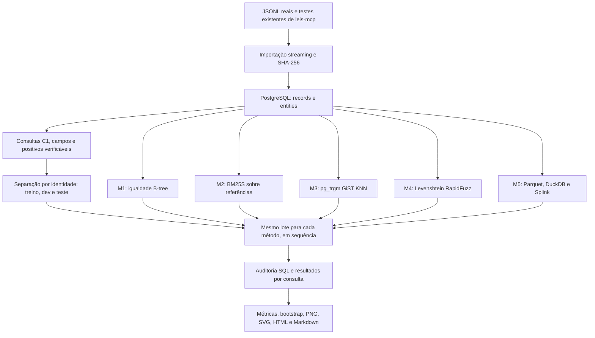

# C1 — execução real e arquitetura reproduzível

## Escopo entregue

Esta branch implementa exclusivamente C1: localizar a identidade explicitamente referenciada. C2 pesquisa expressão/trecho; C3 procura fundamentos para um problema descrito. Nenhum método C1 desta rodada procura similaridade de teses ou fatos.

Fonte: [leis-mcp](https://github.com/lops-legal/leis-mcp), arquivos locais `.local/normalizado/precedentes.jsonl` e `dispositivos.jsonl`. O repositório-fonte foi apenas lido. O clone público pode não conter esses arquivos grandes: a reprodução exige o mesmo snapshot local; o código não promete que `git clone` baixa os JSONL.

| Coleção | Registros físicos | Identidades distintas |
|---|---:|---:|
| Dispositivos legais | 347.195 | 330.574 |
| Precedentes | 11.253 | 11.253 |
| Total | 358.448 | 341.827 |

Os dispositivos incluem fragmentos que compartilham norma+artigo. C1 agrupa esses fragmentos pela identidade `URN#artigo`, preservando cada registro original em outra tabela. Precedentes usam a chave original da fonte. O universo é legislação + precedentes, não um corpus de 370 mil acórdãos. Hashes SHA-256 completos e duração da importação estão no [manifesto](../../reports/c1/real/corpus-manifest.json).

## Pipeline implementado



Parquet é o formato intermediário do M5; PostgreSQL é o banco operacional desta rodada. Iceberg não foi instalado: não há nesta tarefa C1 requisito demonstrado de catálogo distribuído que justifique seu custo. Manticore, pgvector e modelos BERT pertencem a outras comparações de implementação/recuperação; não foram executados nem aparecem como resultados desta branch.

## Módulos e dependências efetivas

| Método | Implementação efetiva | Referência | Parâmetros desta rodada |
|---|---|---|---|
| M1 | PostgreSQL 18 + psycopg | [Bayer–McCreight](https://doi.org/10.1007/BF00288683), [código](https://github.com/postgres/postgres) | Campos presentes; igualdade; índice composto; sem decisão inventada para ambiguidade |
| M2 | BM25S 0.3.16 | [arXiv:2407.03618](https://arxiv.org/abs/2407.03618), [código](https://github.com/xhluca/bm25s) | Variante Lucene; k1=1,2; b=0,75; sem stemming/stopwords; backend NumPy; 1 thread |
| M3 | pg_trgm GiST | [Ukkonen](https://doi.org/10.1016/0304-3975(92)90143-4), [código](https://github.com/postgres/postgres/tree/master/contrib/pg_trgm) | siglen=64; distância `<->`; top-100; sem limiar; plano KNN confirmado |
| M4 | RapidFuzz 3.14.6 | [Wagner–Fischer](https://doi.org/10.1145/321796.321811), [código](https://github.com/rapidfuzz/RapidFuzz) | Similaridade Levenshtein normalizada; pesos 1/1/1; comparação exaustiva dentro da coleção |
| M5 | Splink 5 + DuckDB 2 + PyArrow | [Fellegi–Sunter](https://doi.org/10.1080/01621459.1969.10501049), [Splink](https://doi.org/10.23889/ijpds.v7i3.1794), [código](https://github.com/moj-analytical-services/splink) | link_only; bloqueio coleção+número; u amostrado até 100 mil pares; m em 95 consultas de treino; DuckDB 256 MB/2 threads |

O artigo de q-grams fundamenta a família; não se afirma que pg_trgm reproduza o algoritmo de Ukkonen. As dependências completas estão em [requirements-c1.lock.txt](../../requirements-c1.lock.txt). Cada resultado registra as versões realmente carregadas e o commit de código. Revisão upstream inspecionada e versão do pacote executado são evidências diferentes.

M1 utiliza a estrutura dos campos, incluindo chave de norma. M2–M4 recebem uma serialização canônica dos campos de identidade; M5 compara campos separadamente e não usa a chave de norma como comparação. Portanto, comparam-se pipelines concretos completos, não somente funções de score sobre representação idêntica. Uma futura ablação preservará papéis dos números nos métodos textuais; não alterar o baseline após observar o teste e publicar como se fosse a mesma rodada.

### Modelos, APIs e GPU

**Nenhum dos cinco métodos usa embeddings, LLMs, OpenRouter, NVIDIA ou GPU.** M5 estima parâmetros estatísticos locais. Não são necessárias chaves para reproduzir C1; nenhuma chave foi escrita no Git. O custo de API medido é zero. Custo monetário de CPU/energia local não foi estimado.

## Consultas, positivos e divisão

- Sete chamadas individuais de `consulta_direta` em `tests/consultas_referencia.json` da fonte; a chamada em lote de conferência de citações fica fora por ter outro contrato.
- 500 consultas derivadas de identidades reais: 250 por coleção, selecionadas deterministicamente por hash. Não são histórias jurídicas geradas, erros artificiais ou logs de usuários.
- Total: 507 consultas; treino 95, dev 107, teste 305. As sete chamadas existentes ficam em teste; as 500 derivadas recebem divisão por hash da identidade. A auditoria confirma ausência de identidade compartilhada entre divisões.
- As consultas derivadas possuem como positivo a identidade de origem. Nas chamadas parciais, todos os objetos compatíveis com os campos existentes são positivos. `STJ 385`, por exemplo, admite mais de um tipo no snapshot: não se inventa a intenção ausente.
- A construção dos positivos é baseada em identidade/metadados, não em julgamento humano independente de pertinência. Isso é apropriado ao teste restrito de localização conhecida e cria uma vantagem esperada para igualdade. Não comprova SOTA jurídico geral.
- Aliases são lidos do dicionário já existente na fonte com AST; nenhum código do projeto-fonte é executado para isso. Corpo e ementa não entram no ranking C1.
- Não foram criadas referências com erros nem alvos inexistentes. As respectivas métricas permanecem não medidas.

M5 usa somente o treino para estimação. Níveis de discordância não observados mantêm padrões do Splink; não há alegação de calibração probabilística. A regra de bloqueio exige número exato e não pode recuperar um número digitado incorretamente. A primeira rodada usa parâmetros fixos documentados, sem busca de hiperparâmetros no teste; as grades das fichas são propostas futuras.

## Reproduzir nesta máquina

Use um checkout dedicado de `c1`, evitando mudar a branch do outro agente. Defina `LEIS_MCP_ROOT` com o caminho do clone que contém os JSONL reais. O código não instala nem modifica `leis-mcp`.

```powershell
python -m venv .venv
.\.venv\Scripts\python.exe -m pip install -r requirements-c1.lock.txt
$env:LEIS_MCP_ROOT = 'CAMINHO_DO_CLONE_REAL'
$env:LOPSIR_C1_DSN = 'host=127.0.0.1 port=55431 user=lopsir dbname=postgres connect_timeout=10'
```

O PostgreSQL local foi iniciado na porta 55431, somente em loopback, para evitar o banco de outro agente. Distribuição: [EDB PostgreSQL 18.0 Windows x64](https://get.enterprisedb.com/postgresql/postgresql-18.0-1-windows-x64-binaries.zip). SHA-256 do ZIP: `4a1ea6e6ecbde1747103c7b5bc0674cc415b9aa8ef7b7bad3a4ee38c37c051b1`. A extração local em `work/postgresql/pgsql` não é versionada.

Em uma instalação nova, depois de extrair e conferir o hash, inicialize uma pasta **vazia**. Não execute `initdb` sobre dados existentes. A configuração trust usada no experimento é somente para esse servidor local de testes em loopback; não é configuração de serviço público.

```powershell
& work/postgresql/pgsql/bin/initdb.exe -D work/pgdata -U lopsir --auth=trust --encoding=UTF8
& work/postgresql/pgsql/bin/pg_ctl.exe -D work/pgdata -l work/postgres.log -o '-h 127.0.0.1 -p 55431 -c shared_buffers=64MB -c work_mem=4MB -c maintenance_work_mem=128MB -c max_connections=12' start
```

O importador substitui as tabelas **do schema c1**; não o execute durante um benchmark. Não afeta arquivos da fonte nem tabelas de outros schemas.

```powershell
.\.venv\Scripts\python.exe -m c1.data --source-root $env:LEIS_MCP_ROOT --output reports/c1/real
.\.venv\Scripts\python.exe -m c1.queries --source-root $env:LEIS_MCP_ROOT --output artifacts/c1/queries.jsonl
.\.venv\Scripts\python.exe -m c1.run --method m1 --repetitions 3
.\.venv\Scripts\python.exe -m c1.run --method m2 --repetitions 3
.\.venv\Scripts\python.exe -m c1.run --method m3 --repetitions 3
.\.venv\Scripts\python.exe -m c1.run --method m4 --repetitions 3
.\.venv\Scripts\python.exe -m c1.run --method m5 --repetitions 3
.\.venv\Scripts\python.exe -m c1.audit
.\.venv\Scripts\python.exe -m c1.results.publish
.\.venv\Scripts\python.exe -m unittest discover -s tests -v
```

Cada execução substitui o resultado anterior daquele método no mesmo diretório; para uma rodada nova, use outro `--output` e mantenha snapshots/configuração. O runner continua registrando falhas como zero de qualidade; o publicador exige cinco resultados completos sem falhas antes de montar esta comparação. Não executar métodos em paralelo para medir latência.

## Critérios, cobertura e pendências científicas

Medidos em todos: Hit@1, MRR@10, nDCG@10, Recall/Precision@10/20/100, p50/p95/p99, chamadas, falhas, preparo, pico RSS do Python e custo de API. Auditoria adicional: hashes, contagens, grounding dos positivos, divisão por identidade, bytes de índices e plano KNN.

Não medidos: parsing livre ponta a ponta, carga concorrente, cache frio controlado, watts, custo monetário local, SLA de atualização, decisão automática calibrada, rejeição de inexistentes e erros reais de digitação. Nenhum campo não medido vira zero. Preparo não equivale ao mesmo estágio em todos os métodos; RSS não inclui o PostgreSQL. Ver os detalhes no [relatório](../../reports/c1/real/README.md).

Hipóteses desta rodada:

| Hipótese | Evidência inicial | Próximo teste legítimo |
|---|---|---|
| C1-H1: igualdade é suficiente e econômica para referências completas | M1 tem 100% Hit@1 no lote e menor p95 observado | Repetir em logs reais independentes, carga e versões de norma |
| C1-H2: métodos aproximados ajudam referências incompletas/divergentes | Não estabelecido; conjunto majoritariamente íntegro | Coletar consultas reais com divergência e anotação de identidade |
| C1-H3: serialização pode confundir papel dos números | Erros reais M2/M3 entre reedição e artigo | Ablação em dev preservando papéis, sem reusar teste como dev |
| C1-H4: vinculação de campos melhora casos incompletos | M5 resolve o lote, mas sem ganho observado sobre M1 e com maior latência | Pares reais divergentes, avaliação de bloqueio e calibração |
| C1-H5: resultados agregados ocultam diferenças de coleção | Subgrupos e gráfico publicados separadamente | Ampliar amostra de precedentes e tipos raros com consultas reais |

As conclusões são restritas ao lote. Um novo teste que altere consultas, representação, regras ou parâmetros recebe nova identificação e novo relatório, preservando esta rodada no Git.
