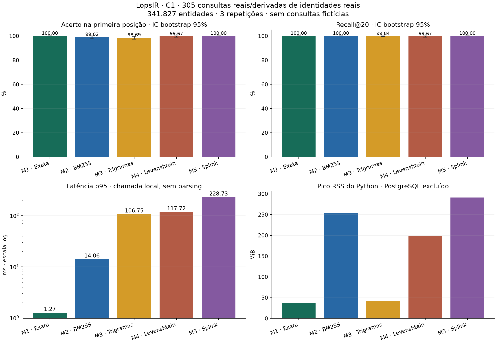
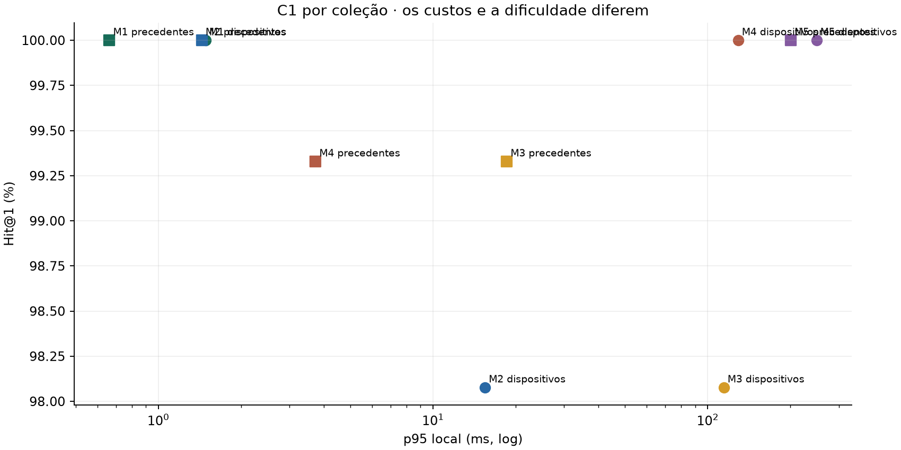

# Resultados reais de C1 — primeira rodada

Fonte: acervo local de [leis-mcp](https://github.com/lops-legal/leis-mcp). 358.448 registros físicos: 347.195 dispositivos legais e 11.253 precedentes. Deduplicação de identidade: 341.827 entidades. **Não são 370 mil acórdãos.**

**305 consultas de teste**, as mesmas para os cinco métodos: 7 chamadas estruturadas já existentes nos testes da fonte e 298 consultas derivadas exclusivamente de campos reais de identidade. 95 consultas em treino e 107 em desenvolvimento. Nenhum caso jurídico fictício, nenhuma adulteração de referência.

| Método | Hit@1 | MRR@10 | Recall@20 | nDCG@10 | p50 ms | p95 ms | p99 ms | Preparo s | RSS Python MiB |
|---|---:|---:|---:|---:|---:|---:|---:|---:|---:|
| M1 · Exata | 100.0000% | 1.0000 | 100.0000% | 1.0000 | 0.380 | 1.269 | 1.862 | 0.00 | 36.4 |
| M2 · BM25S | 99.0164% | 0.9951 | 100.0000% | 0.9961 | 5.130 | 14.055 | 18.075 | 11.43 | 254.5 |
| M3 · Trigramas | 98.6885% | 0.9934 | 99.8361% | 0.9944 | 23.663 | 106.745 | 121.221 | 7.86 | 42.8 |
| M4 · Levenshtein | 99.6721% | 0.9967 | 99.6721% | 0.9967 | 83.158 | 117.717 | 143.189 | 1.33 | 198.9 |
| M5 · Splink | 100.0000% | 1.0000 | 100.0000% | 1.0000 | 169.783 | 228.732 | 311.019 | 4.46 | 291.2 |

## O que estes números permitem concluir

A busca exata é a referência operacional para identidades estruturadas e íntegras deste lote. O positivo das consultas derivadas é a própria identidade de origem; o positivo das chamadas parciais é o conjunto compatível com os campos fornecidos. Isso favorece naturalmente igualdade e não é avaliação cega de relevância semântica. Não extrapolar para C2/C3, identificadores digitados incorretamente ou referências ausentes.

BM25 e trigramas podem perder a função dos números na serialização: número de reedição e artigo podem trocar de posição e manter os mesmos tokens. Levenshtein sobre a referência inteira pode preferir uma referência curta incorreta quando a consulta omite o tipo. Os arquivos por consulta mostram os erros reais.

M5 usa bloqueio por coleção+número e parâmetros Fellegi–Sunter estimados em treino. Os níveis de discordância não observados em treino mantêm padrões da biblioteca. Seus scores não são probabilidades calibradas e o bloqueio não tolera erro no número. As tentativas operacionais malsucedidas estão em `../attempts/` e não entram nesta tabela.

## Medição e limites

- Cada método percorreu 305 consultas × 3 repetições = 915 chamadas; falhas finais: zero. As consultas e tempos foram registrados em `c1.query_audit` no PostgreSQL.
- A latência inclui a chamada ao banco ou motor em processo, pontuação e limpeza de tabelas quando aplicável. Exclui parsing da entrada original, HTTP, fila de produção e escrita do próprio log de auditoria.
- Os testes foram sequenciais em máquina compartilhada; não há isolamento de CPU nem carga concorrente controlada. QPS serial não representa capacidade em produção. Cache frio não foi controlado.
- Preparo não é uma comparação homogênea de construção completa: M1 já possui índices da importação; M3 inclui construção GiST na primeira rodada; M2/M4 carregam dados; M5 exporta, materializa e treina.
- RSS é apenas do processo Python; servidor PostgreSQL e cache do sistema ficam de fora. Tamanho dos índices e plano KNN real estão em `audit.json`.
- ICs bootstrap por conjunto de identidade, 10.000 reamostragens, semente 42: `statistics.json`. São incertezas deste lote selecionado; 100% observado não demonstra perfeição universal.
- Precisão@20 divide por 20 mesmo quando C1 tem apenas uma identidade relevante; portanto 5% pode ser compatível com resposta correta e completa. Hit@1 e Recall são mais interpretáveis aqui.
- Recall@20 = fração das identidades corretas conhecidas encontrada nas primeiras 20 posições. Não é acurácia global nem precisão da lista.
- Custo de API: US$ 0; chamadas: 0. Custo monetário local, consumo elétrico, SLA de atualização, taxa de falsa aceitação de inexistentes e tolerância a erros: não medidos, não presumidos nulos.

## Dados completos e reprodução

Cada pasta `m1`…`m5` contém `summary.json` e `per-query.jsonl`: campos reais, positivos, ranking, tempos individuais, versões, commit de código e parâmetros. Ver [execução](../../../docs/c1/EXECUCAO.md).

## Sete consultas já existentes na fonte

| Consulta | M1 Hit@1 | M2 Hit@1 | M3 Hit@1 | M4 Hit@1 | M5 Hit@1 |
|---|---:|---:|---:|---:|---:|
| CDC artigo 51 | 1 | 1 | 1 | 1 | 1 |
| Lei 10.406/2002 artigo 1.028 | 1 | 1 | 1 | 1 | 1 |
| Constituição artigo ADCT 10 | 1 | 1 | 1 | 1 | 1 |
| CLT artigo 482 | 1 | 1 | 1 | 1 | 1 |
| STJ 385 | 1 | 1 | 0 | 0 | 1 |
| STF vinculante 13 | 1 | 1 | 1 | 1 | 1 |
| STF repercussão 1002 | 1 | 1 | 1 | 1 | 1 |
