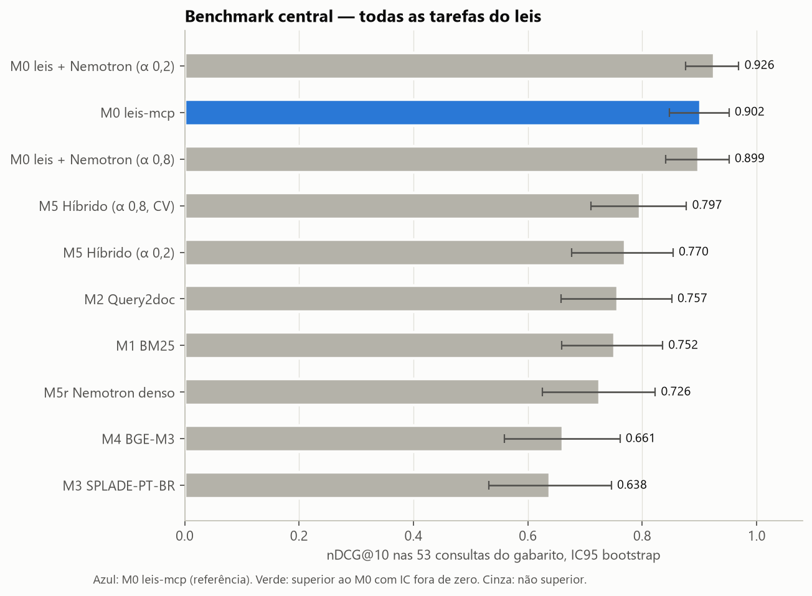
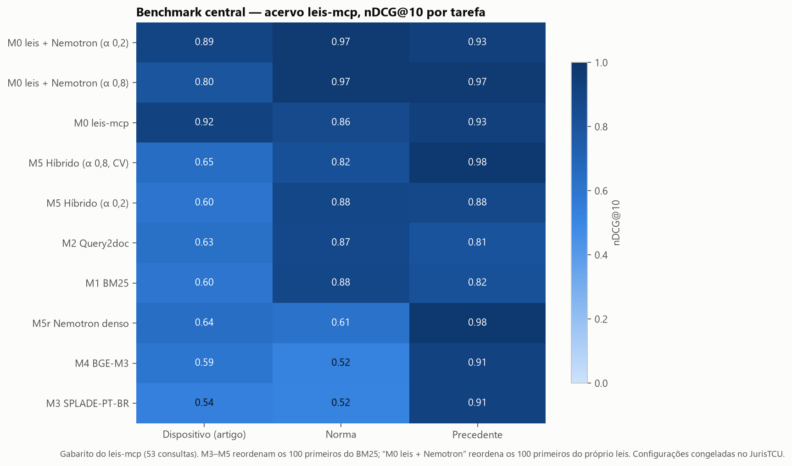

# Benchmark C2 — central no acervo leis-mcp, JurisTCU nas lacunas (gerado)

Commit `3531f54e47`. **Benchmark central:** o acervo do leis-mcp (347.195 dispositivos de legislação federal e
11.253 precedentes qualificados), com o gabarito conferido do próprio leis-mcp (`tests/consultas_referencia.json`):
53 consultas C2 em três tarefas, mais 8 consultas diretas (C1). **Auxiliar:** o JurisTCU entra só onde o leis não
consegue medir (relevância graduada, consultas reais, denso no corpus inteiro, ajuste em dev, busca vetorial em banco).

Protocolo no leis: nenhum ajuste (o gabarito inteiro é teste); M1–M5 chegam com a configuração congelada no dev do JurisTCU;
M3, M4 e M5 reordenam os 100 primeiros do M1 (protocolo "rerank" do JUÁ), porque codificar os 358 mil documentos não cabe
na máquina. O M0 é o leis-mcp como servido, e reproduz as métricas publicadas no próprio repositório.

## Métricas e de onde vêm

| Métrica | Origem | Medida no leis (central) | Medida no JurisTCU (lacuna) |
|---|---|---|---|
| nDCG@10 | JUÁ (Tabela 2), BEIR | leis (binário) | TCU: relevância graduada 0–3 |
| MRR@10 | JUÁ (Figuras), leis METRICAS | leis | TCU |
| MAP@10 | JUÁ (Figuras) | leis | TCU |
| Recall@10 | JUÁ (Figuras) | leis | TCU |
| acerto@1 / @3 / @10 | leis METRICAS | leis | TCU (Hit@1) |
| Recall@100, P@10 | BEIR, SDD §2.2 | leis (R@100 dentro de 100 candidatos) | TCU |
| Judged@10 | SDD §2.2 | — (gabarito com 1–3 positivos) | TCU |
| IC95 pareado (bootstrap) | SDD §13 | leis (53 consultas agregadas) | TCU (70 consultas) |
| Latência p50/p95/p99, QPS | SDD §13, leis METRICAS | leis | TCU |
| Tamanho da resposta (tokens) | leis METRICAS | leis (M0) | — |
| Consultas diretas (C1) | leis METRICAS | leis (M0) | — |
| Tempo de construção, bytes de índice, RAM | SDD §5.3 (R06, R09) | leis (Manticore × DuckDB) | TCU (todos os motores) |
| ANN-recall@k | SDD §2.2 | — (sem denso no corpus inteiro) | TCU (DuckDB HNSW × exato) |
| Ajuste em dev / validação cruzada | SDD §6.6, §9 | — (só teste) | TCU (dev 30 + CV 100) |

## Resultado central — todas as tarefas juntas

| Sistema | nDCG@10 (53 consultas) | IC95 | Δ vs M0 leis [IC95] | Veredito |
|---|---:|---|---|---|
| M0 leis + Nemotron (α 0,2) | 0,926 | 0,876 a 0,969 | +0,024 [-0,014; +0,067] | inconclusivo |
| M0 leis-mcp | 0,902 | 0,847 a 0,952 | — | referência |
| M0 leis + Nemotron (α 0,8) | 0,899 | 0,841 a 0,952 | -0,003 [-0,069; +0,063] | inconclusivo |
| M5 Híbrido (α 0,8, CV) | 0,797 | 0,710 a 0,877 | -0,106 [-0,198; -0,016] | inferior |
| M5 Híbrido (α 0,2) | 0,770 | 0,677 a 0,854 | -0,132 [-0,221; -0,052] | inferior |
| M2 Query2doc | 0,757 | 0,658 a 0,852 | -0,145 [-0,242; -0,052] | inferior |
| M1 BM25 | 0,752 | 0,659 a 0,836 | -0,151 [-0,237; -0,073] | inferior |
| M5r Nemotron denso | 0,726 | 0,626 a 0,823 | -0,176 [-0,284; -0,067] | inferior |
| M4 BGE-M3 | 0,661 | 0,559 a 0,761 | -0,241 [-0,347; -0,138] | inferior |
| M3 SPLADE-PT-BR | 0,638 | 0,532 a 0,746 | -0,264 [-0,372; -0,153] | inferior |

## Resultado central por tarefa

### Dispositivo (artigo) — 21 consultas

| Sistema | nDCG@10 | MRR@10 | MAP@10 | R@10 | acerto@1 | acerto@3 | acerto@10 | R@100 | P@10 | p50 ms | p95 ms |
|---|---:|---:|---:|---:|---:|---:|---:|---:|---:|---:|---:|
| **M0 leis-mcp** | 0,918 | 0,909 | 0,889 | 0,976 | 86% | 95% | 100% | 0,976 | 0,114 | 35 | 178 |
| M0 leis + Nemotron (α 0,2) | 0,893 | 0,869 | 0,859 | 0,976 | 81% | 95% | 100% | 0,976 | 0,114 | 1318 | 7030 |
| M0 leis + Nemotron (α 0,8) | 0,797 | 0,746 | 0,733 | 0,976 | 62% | 81% | 100% | 0,976 | 0,114 | 4306 | 10627 |
| M5 Híbrido (α 0,8, CV) | 0,647 | 0,596 | 0,584 | 0,833 | 48% | 71% | 86% | 0,952 | 0,100 | 695 | 5360 |
| M5r Nemotron denso | 0,639 | 0,628 | 0,578 | 0,786 | 57% | 62% | 81% | 0,952 | 0,095 | 665 | 1220 |
| M2 Query2doc | 0,629 | 0,585 | 0,579 | 0,786 | 52% | 57% | 81% | 0,976 | 0,090 | 328 | 5437 |
| M5 Híbrido (α 0,2) | 0,604 | 0,572 | 0,549 | 0,746 | 48% | 62% | 81% | 0,952 | 0,086 | 33942 | 45541 |
| M1 BM25 | 0,599 | 0,565 | 0,541 | 0,746 | 48% | 62% | 81% | 0,952 | 0,086 | 38 | 83 |
| M4 BGE-M3 | 0,592 | 0,603 | 0,551 | 0,667 | 57% | 57% | 71% | 0,952 | 0,081 | 8526 | 14994 |
| M3 SPLADE-PT-BR | 0,536 | 0,510 | 0,488 | 0,651 | 43% | 52% | 71% | 0,952 | 0,076 | 4534 | 4890 |

### Norma — 17 consultas

| Sistema | nDCG@10 | MRR@10 | MAP@10 | R@10 | acerto@1 | acerto@3 | acerto@10 | R@100 | P@10 | p50 ms | p95 ms |
|---|---:|---:|---:|---:|---:|---:|---:|---:|---:|---:|---:|
| M0 leis + Nemotron (α 0,8) | 0,967 | 1,000 | 0,950 | 0,971 | 100% | 100% | 100% | 0,971 | 0,106 | 3371 | 9605 |
| M0 leis + Nemotron (α 0,2) | 0,967 | 1,000 | 0,950 | 0,971 | 100% | 100% | 100% | 0,971 | 0,106 | 910 | 7268 |
| M1 BM25 | 0,881 | 0,855 | 0,844 | 0,971 | 76% | 94% | 100% | 0,971 | 0,106 | 24 | 39 |
| M5 Híbrido (α 0,2) | 0,881 | 0,855 | 0,844 | 0,971 | 76% | 94% | 100% | 0,971 | 0,106 | 6137 | 27954 |
| M2 Query2doc | 0,871 | 0,868 | 0,850 | 0,912 | 82% | 88% | 94% | 0,971 | 0,100 | 565 | 3400 |
| **M0 leis-mcp** | 0,862 | 0,878 | 0,820 | 0,941 | 82% | 94% | 100% | 0,971 | 0,100 | 17 | 51 |
| M5 Híbrido (α 0,8, CV) | 0,823 | 0,781 | 0,768 | 0,971 | 65% | 94% | 100% | 0,971 | 0,106 | 643 | 2776 |
| M5r Nemotron denso | 0,614 | 0,556 | 0,549 | 0,794 | 41% | 76% | 82% | 0,971 | 0,088 | 745 | 1985 |
| M4 BGE-M3 | 0,524 | 0,437 | 0,431 | 0,794 | 24% | 53% | 82% | 0,971 | 0,088 | 7614 | 11513 |
| M3 SPLADE-PT-BR | 0,522 | 0,491 | 0,456 | 0,706 | 41% | 47% | 76% | 0,971 | 0,076 | 3715 | 4564 |

### Precedente — 15 consultas

| Sistema | nDCG@10 | MRR@10 | MAP@10 | R@10 | acerto@1 | acerto@3 | acerto@10 | R@100 | P@10 | p50 ms | p95 ms |
|---|---:|---:|---:|---:|---:|---:|---:|---:|---:|---:|---:|
| M5 Híbrido (α 0,8, CV) | 0,975 | 0,967 | 0,967 | 1,000 | 93% | 100% | 100% | 1,000 | 0,100 | 552 | 963 |
| M5r Nemotron denso | 0,975 | 0,967 | 0,967 | 1,000 | 93% | 100% | 100% | 1,000 | 0,100 | 650 | 3837 |
| M0 leis + Nemotron (α 0,8) | 0,967 | 0,956 | 0,956 | 1,000 | 93% | 100% | 100% | 1,000 | 0,100 | 1591 | 7630 |
| **M0 leis-mcp** | 0,926 | 0,900 | 0,900 | 1,000 | 80% | 100% | 100% | 1,000 | 0,100 | 22 | 175 |
| M0 leis + Nemotron (α 0,2) | 0,926 | 0,900 | 0,900 | 1,000 | 80% | 100% | 100% | 1,000 | 0,100 | 755 | 7283 |
| M3 SPLADE-PT-BR | 0,913 | 0,883 | 0,883 | 1,000 | 80% | 93% | 100% | 1,000 | 0,100 | 4346 | 4442 |
| M4 BGE-M3 | 0,913 | 0,883 | 0,883 | 1,000 | 80% | 93% | 100% | 1,000 | 0,100 | 12953 | 14813 |
| M5 Híbrido (α 0,2) | 0,877 | 0,833 | 0,833 | 1,000 | 67% | 100% | 100% | 1,000 | 0,100 | 9675 | 15177 |
| M1 BM25 | 0,819 | 0,756 | 0,756 | 1,000 | 53% | 100% | 100% | 1,000 | 0,100 | 31 | 49 |
| M2 Query2doc | 0,805 | 0,764 | 0,764 | 0,933 | 67% | 87% | 93% | 1,000 | 0,093 | 148 | 2535 |

## Consultas diretas (C1) — só o leis

Acerto@1: **100%** em 8 consultas diretas.

| Tool | Argumentos | Acertou | ms (mediana de 3) |
|---|---|---|---:|
| obter_dispositivo | norma=CDC, artigo=51 | sim | 11.5 |
| obter_dispositivo | norma=Lei 10.406/2002, artigo=1.028 | sim | 11.8 |
| obter_dispositivo | norma=Constituição, artigo=ADCT 10 | sim | 11.6 |
| obter_dispositivo | norma=CLT, artigo=482 | sim | 12.5 |
| obter_precedente | tribunal=STJ, numero=385 | sim | 1.5 |
| obter_precedente | tribunal=STF, numero=13, tipo=vinculante | sim | 1.5 |
| obter_precedente | tribunal=STF, numero=1002, tipo=repercussão | sim | 1.4 |
| conferir_citacoes | citacoes=['Súmula 549 do STJ', 'art. 3º, VII, da Lei 8.009/1990', 'Tema 1127 do STF'] | sim | 26.5 |

## Tamanho da resposta do leis (uso normal, limite=10)

| Tarefa | Resposta média (caracteres) | ≈ tokens |
|---|---:|---:|
| dispositivo | 7.133 | 1.783 |
| norma | 4.311 | 1.078 |
| precedente | 5.291 | 1.323 |
| norma_por_artigos | 3.659 | 915 |

## Motores no acervo central — o mesmo BM25 em Manticore e DuckDB

| Tarefa | Manticore BM25 nDCG@10 | DuckDB FTS BM25 nDCG@10 | Manticore p50 ms | DuckDB p50 ms |
|---|---:|---:|---:|---:|
| Dispositivo (artigo) | 0,599 | 0,438 | 38 | 336 |
| Norma | 0,881 | 0,784 | 24 | 343 |
| Precedente | 0,819 | 0,844 | 31 | 77 |

DuckDB 2.0.0: base de 234 MiB; carga 11 s e índice FTS 58 s para 347,195 dispositivos e 11,253 precedentes. Manticore do leis: índice de 641 MB e ~150 MB de RAM (docs do leis-mcp).

## Lacunas do leis cobertas pelo JurisTCU

| Lacuna do leis | O que o JurisTCU mede | Resultado |
|---|---|---|
| Relevância graduada (gabarito do leis é binário) | nDCG@10 com graus 0–3 em 70 consultas | melhor: M5 Híbrido 0,364; BM25 0,341; M0 leis 0,264 |
| Consultas reais de usuários | 35 palavras-chave reais × 35 sintéticas | M0 leis 0,180 nas reais; BM25 0,195 |
| Denso no corpus inteiro (no leis só reordena 100) | Nemotron 8B exato sobre 16.045 docs | 0,386 (BM25 0,341) |
| Split de ajuste (leis só tem teste) | dev de 30 + validação cruzada em 100 | α da fusão: 0,2 no dev, 0,8 na CV (híbrido 0,385 × BM25 0,357) |
| Busca vetorial em banco (DuckDB VSS) | HNSW × exato com os mesmos vetores | ANN-recall@10 1,000; nDCG@10 HNSW 0,385 × exato 0,385 |
| Híbrido dentro do banco | BM25 FTS + cosseno + fusão numa consulta SQL | nDCG@10 0,364, p50 506 ms |

### Motores no JurisTCU (BM25 em três bancos, denso exato × HNSW, híbrido em SQL)

| Motor | nDCG@10 | p50 ms | p95 ms | Construção | Observação |
|---|---:|---:|---:|---|---|
| bm25s 0.3.16 (numpy) | 0,341 | 0.6 | 1.6 | — |  |
| Manticore 9.3.2 RT table (HTTP SQL) | 0,314 | 6.3 | 11.7 | 18 s | top-10 igual ao de referência em 83% |
| DuckDB FTS match_bm25 | 0,342 | 94.3 | 115.9 | 7 s | top-10 igual ao de referência em 98% |
| numpy float32 matrix | 0,385 | 22.3 | 27.4 | — |  |
| DuckDB array_cosine_similarity (scan) | 0,385 | 380.6 | 512.5 | 160 s | top-10 igual ao de referência em 100% |
| DuckDB VSS HNSW (cosine) | 0,385 | 466.2 | 623.1 | 27 s | ANN-recall@10 1,000 |
| DuckDB one SQL statement (FTS + cosine + convex fusion) | 0,364 | 505.8 | 775.9 | — |  |

Detalhes do JurisTCU: [RESULTS.md](RESULTS.md) e [ERRORS.md](ERRORS.md).
