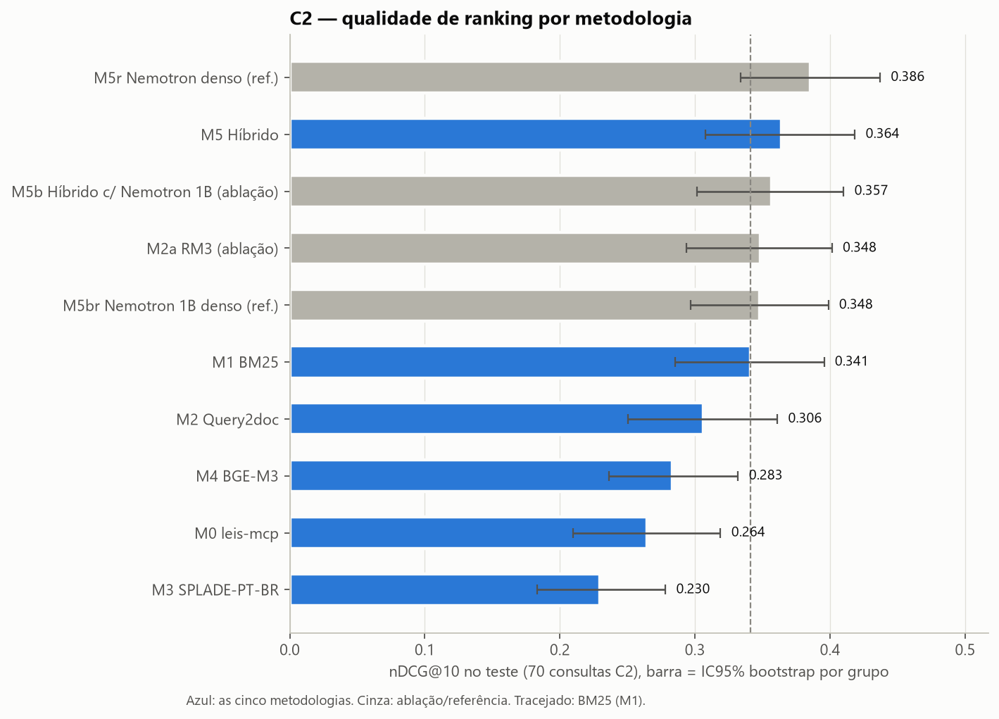
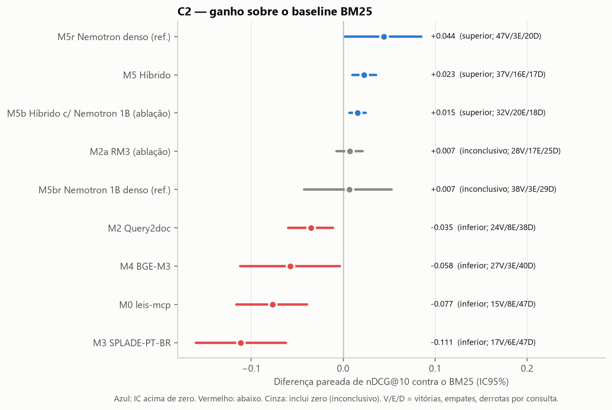
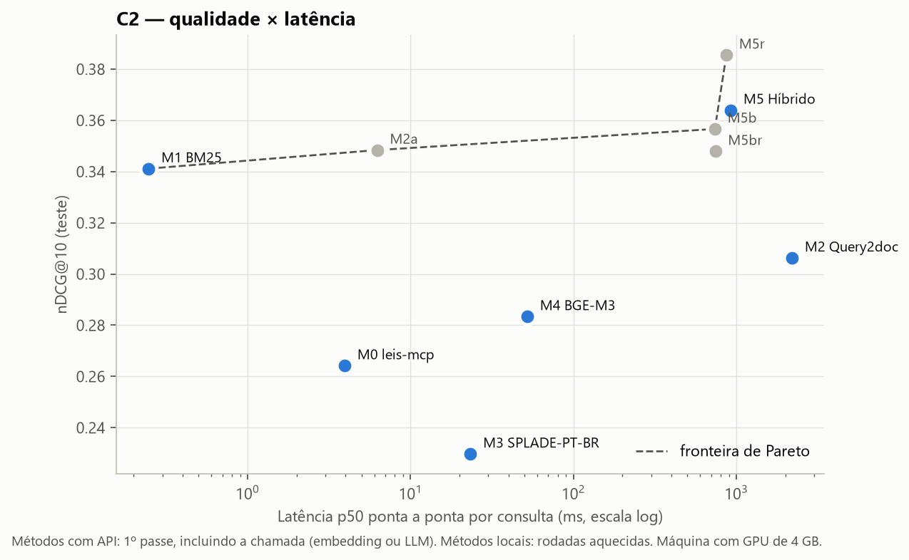
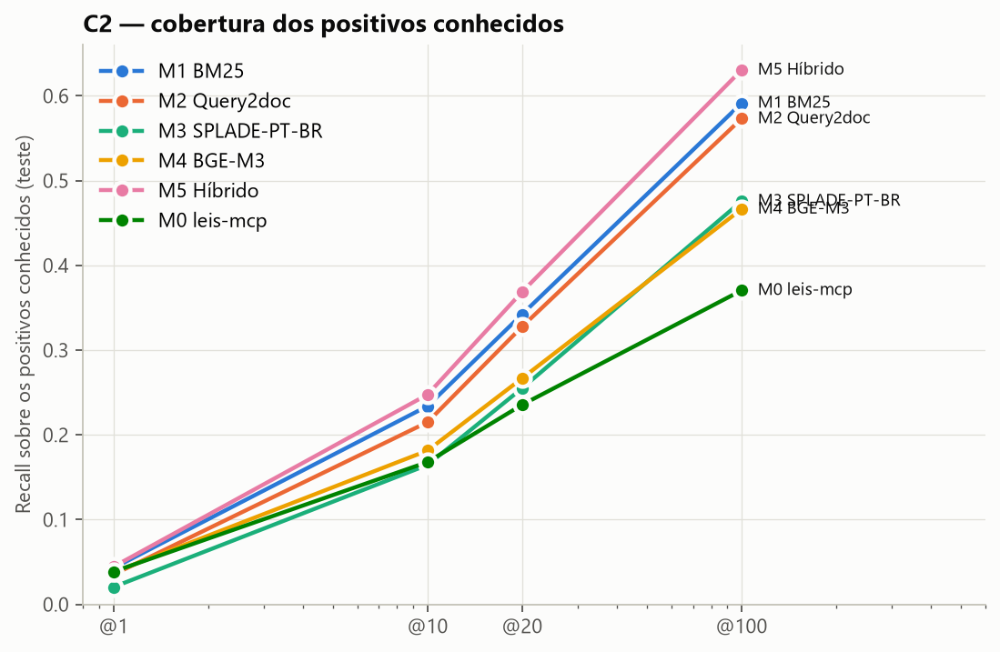
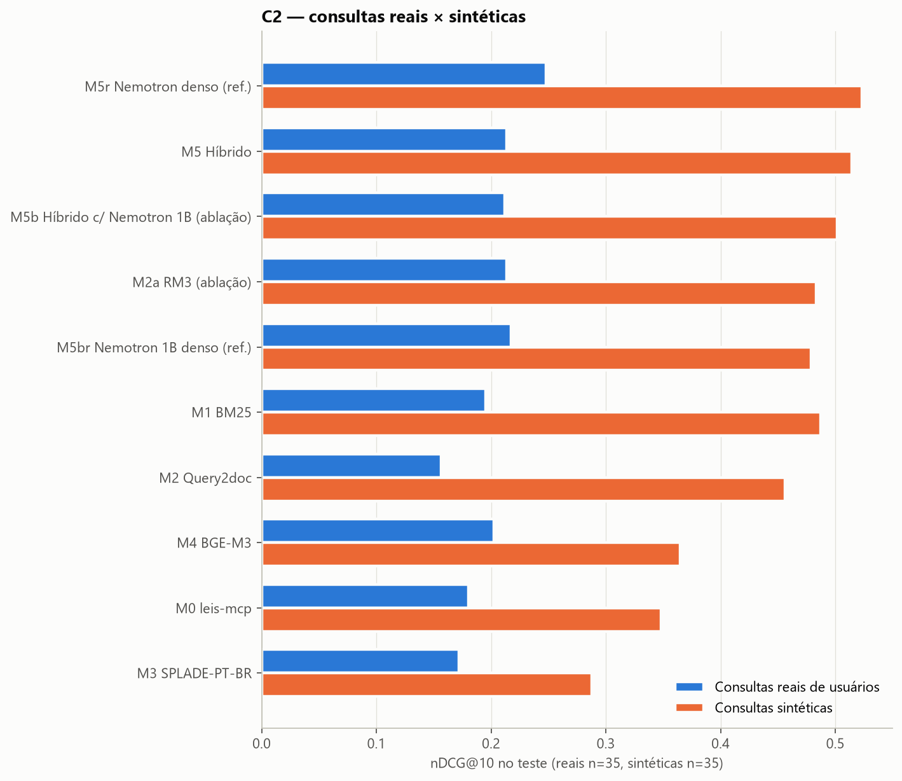
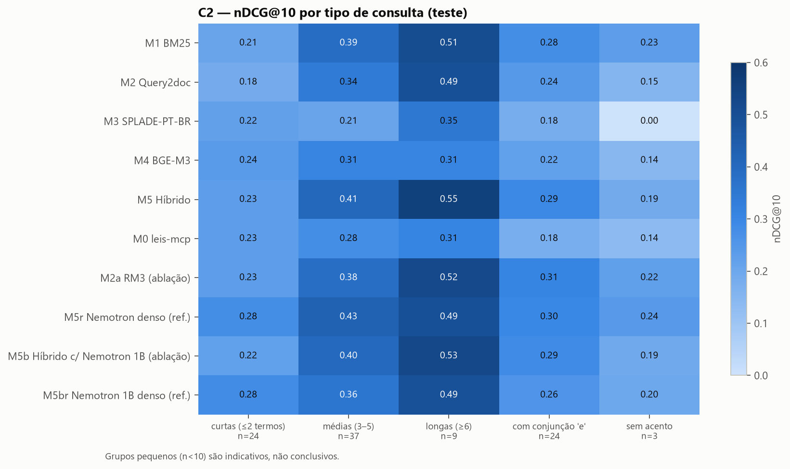
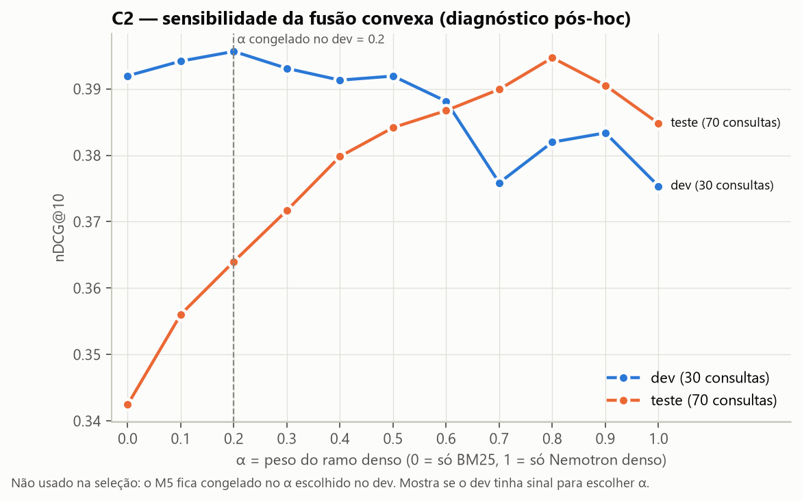
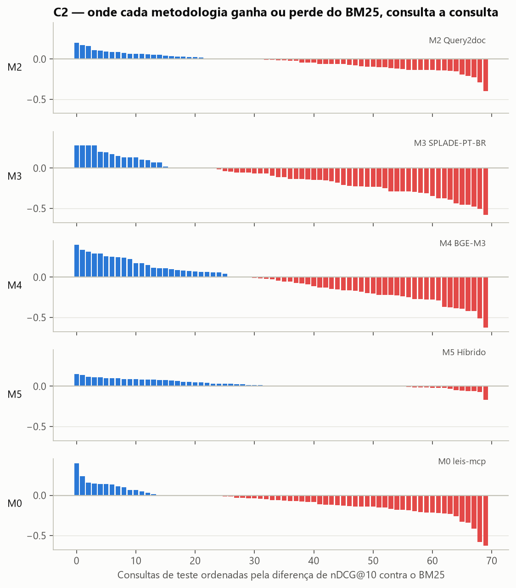

# C2 — resultados comparativos (gerado)

Gerado em 2026-10-30 05:37 UTC a partir de `reports/c2/*/result.json`, commit `3531f54e47`.
Conjunto: JurisTCU (EXCERTO, 16.045 documentos), **70 consultas C2 de teste** (35 reais + 35 sintéticas), qrels 0–3 originais.
Configurações escolhidas só no dev (30 consultas) pela nDCG@10 e avaliadas uma vez no teste.
IC95%: bootstrap pareado, 10,000 reamostragens de grupos de consulta, semente 42.
Veredito contra o BM25: *superior/inferior* só quando o IC95% da diferença exclui zero; caso contrário *inconclusivo*.
Itálico = ablação ou referência, não conta entre as cinco metodologias.

## Quadro principal

| Metodologia | Vantagem testada | nDCG@10 [IC95] | Δ vs BM25 [IC95] | Veredito | P@10 | R@20 | R@100 | MRR@10 | p50 ponta a ponta (ms) | RAM pico (MiB) | Tokens API |
|---|---|---|---|---|---|---|---|---|---|---|---|
| *M5r Nemotron denso (ref.)* | ramo denso isolado | 0.386 [0.334, 0.437] | +0.044 [+0.002, +0.085] | superior | 0.326 | 0.364 | 0.643 | 0.674 | 868.3 | 1,020 | 2,088 |
| M5 Híbrido | junta tudo | 0.364 [0.308, 0.418] | +0.023 [+0.010, +0.036] | superior | 0.296 | 0.369 | 0.630 | 0.648 | 923.7 | 1,020 | 2,088 |
| *M5b Híbrido c/ Nemotron 1B (ablação)* | encoder 8x menor | 0.357 [0.301, 0.410] | +0.015 [+0.007, +0.024] | superior | 0.291 | 0.358 | 0.606 | 0.652 | 737.9 | 770 | 2,088 |
| *M2a RM3 (ablação)* | expansão sem LLM | 0.348 [0.294, 0.401] | +0.007 [-0.007, +0.021] | inconclusivo | 0.290 | 0.341 | 0.604 | 0.612 | 6.2 | 762 | 0 |
| *M5br Nemotron 1B denso (ref.)* | ramo denso 1B isolado | 0.348 [0.297, 0.399] | +0.007 [-0.043, +0.053] | inconclusivo | 0.290 | 0.335 | 0.597 | 0.629 | 742.6 | 770 | 2,088 |
| M1 BM25 | mais barata | 0.341 [0.285, 0.396] | — | baseline | 0.280 | 0.342 | 0.591 | 0.614 | 0.2 | 802 | 0 |
| M2 Query2doc | expansão por LLM | 0.306 [0.250, 0.361] | -0.035 [-0.060, -0.011] | inferior | 0.254 | 0.328 | 0.573 | 0.541 | 2197.0 | 762 | 26,249 |
| M4 BGE-M3 | modelo único multilíngue | 0.283 [0.236, 0.332] | -0.058 [-0.112, -0.004] | inferior | 0.220 | 0.267 | 0.466 | 0.588 | 52.1 | 3,364 | 0 |
| M0 leis-mcp | sistema do usuário | 0.264 [0.210, 0.319] | -0.077 [-0.116, -0.039] | inferior | 0.197 | 0.235 | 0.370 | 0.549 | 3.9 | 126 | 0 |
| M3 SPLADE-PT-BR | esparso aprendido | 0.230 [0.183, 0.278] | -0.111 [-0.160, -0.062] | inferior | 0.197 | 0.255 | 0.476 | 0.423 | 23.3 | 2,787 | 0 |

## Hipóteses

| Hipótese (SDD §8) | Evidência no teste | Leitura |
|---|---|---|
| H2 — BM25 ajustado é difícil de superar em C2 | M0 leis-mcp -0.077 [-0.116, -0.039]; M2 Query2doc -0.035 [-0.060, -0.011]; M3 SPLADE-PT-BR -0.111 [-0.160, -0.062]; M4 BGE-M3 -0.058 [-0.112, -0.004]; M5 Híbrido +0.023 [+0.010, +0.036] | rejeitada em parte: superam o BM25 M5 Híbrido; inferiores ao BM25: M0 leis-mcp, M2 Query2doc, M3 SPLADE-PT-BR, M4 BGE-M3 |
| H5 — expansão controlada ajuda C2 (LLM) | Δ nDCG@10 -0.035 [-0.060, -0.011] | inferior contra o BM25 |
| H5 — expansão sem LLM (RM3) | Δ nDCG@10 +0.007 [-0.007, +0.021] | inconclusivo contra o BM25 |
| H7 — SPLADE entra na fronteira qualidade/custo | Δ nDCG@10 -0.111 [-0.160, -0.062]; p50 23.3 ms | inferior contra o BM25 |
| H3 — híbrido aumenta cobertura | Δ R@100 +0.039 [+0.026, +0.054]; Δ nDCG@10 +0.023 [+0.010, +0.036] | cobertura superior, ranking superior |
| H11 — fusão ajustada supera RRF | dev: melhor convexa 0.396 × melhor RRF 0.396 | exploratório (só dev, 30 consultas); configuração congelada `{'fusion': 'convex', 'depth': 1000, 'param': 0.2}` |

## Qualidade × latência

## Cobertura

## Consultas reais × sintéticas

| Metodologia | Reais (n) | Sintéticas (n) |
|---|---|---|
| M5r Nemotron denso (ref.) | 0.248 (35) | 0.523 (35) |
| M5 Híbrido | 0.213 (35) | 0.515 (35) |
| M5b Híbrido c/ Nemotron 1B (ablação) | 0.212 (35) | 0.502 (35) |
| M2a RM3 (ablação) | 0.213 (35) | 0.484 (35) |
| M5br Nemotron 1B denso (ref.) | 0.217 (35) | 0.479 (35) |
| M1 BM25 | 0.195 (35) | 0.487 (35) |
| M2 Query2doc | 0.156 (35) | 0.456 (35) |
| M4 BGE-M3 | 0.202 (35) | 0.365 (35) |
| M0 leis-mcp | 0.180 (35) | 0.348 (35) |
| M3 SPLADE-PT-BR | 0.172 (35) | 0.288 (35) |

## Por tipo de consulta

## Sensibilidade da fusão (diagnóstico pós-hoc)

Curva da fusão convexa do M5 de α=0 (só BM25) a α=1 (só denso), no dev e no teste. Não entra na seleção; mostra se o dev de 30 consultas tinha sinal para escolher α. Dados: [m5_hybrid/fusion_sensitivity.json](m5_hybrid/fusion_sensitivity.json).

### Validação cruzada exploratória do α (5 folds × 10 repetições, 100 consultas)

Cada fold escolhe α nos outros quatro e é pontuado com esse α. Usa consultas de teste dentro da validação: evidência para o próximo ciclo, não substitui o M5 congelado. Dados: [m5_hybrid/fusion_crossval.json](m5_hybrid/fusion_crossval.json).

| Medida (100 consultas) | nDCG@10 |
|---|---|
| Híbrido com α por validação cruzada | 0.385 ± 0.005 |
| BM25 (α=0) | 0.357 |
| Nemotron denso (α=1) | 0.382 |

α escolhidos nos folds: α=0.5: 4, α=0.6: 2, α=0.8: 38, α=0.9: 6. IC95 da diferença contra o BM25 acima de zero em 7 de 10 repetições.

## Consulta a consulta

## Análise de erros

Desacordo lexical × denso, maiores ganhos e perdas contra o BM25 e a tabela consulta × método: [ERRORS.md](ERRORS.md).

## Fichas resumidas

### M0 leis-mcp

- **Método:** M0 leis-mcp: Manticore BM25F + proximidade, sintaxe e busca relaxada do leis
- **Hipótese de vantagem:** o sistema de busca já em produção do usuário, medido no mesmo protocolo dos cinco métodos
- **Artigo:** https://doi.org/10.1561/1500000019 · **Código:** https://github.com/lops-legal/leis-mcp
- **Configuração congelada no dev:** `{'ranker': "expr('10000*bm25f(1.2, 0.3) + 1000*sum(lcs*user_weight)')", 'field_weights': 'titulo=1, texto=1', 'relaxed_quorum': 0.6, 'min_strict_results': 3, 'vocabulary_expansion': True}` (0 configurações testadas; dev nDCG@10 0.264)
- **Teste:** nDCG@10 0.264, nDCG@20 0.292, P@20 0.139, Hit@1 0.457, Judged@10 0.197
- **Latência p50 por etapa (1º passe, ms):** translate 0.1, search 3.8
- **Recursos:** pico RAM 126 MiB; índice 117 MiB; VRAM — MiB; requisições API 0; custo faturado US$ 0.00

### M1 BM25

- **Método:** BM25 ajustado (analisador PT + k1/b no dev)
- **Hipótese de vantagem:** mais barata: CPU, sem modelo, sem chave; baseline dificil de superar em C2 (H2)
- **Artigo:** https://doi.org/10.1561/1500000019 · **Código:** https://github.com/xhluca/bm25s
- **Configuração congelada no dev:** `{'analyzer': 'fold=1-stem=0-stop=1', 'k1': 1.2, 'b': 0.75}` (121 configurações testadas; dev nDCG@10 0.394)
- **Teste:** nDCG@10 0.341, nDCG@20 0.389, P@20 0.205, Hit@1 0.500, Judged@10 0.280
- **Latência p50 por etapa (1º passe, ms):** analyze 0.0, score 0.1, rank 0.1
- **Recursos:** pico RAM 802 MiB; índice 35 MiB; VRAM — MiB; requisições API 0; custo faturado US$ 0.00

### M2 Query2doc

- **Método:** Query2doc: expansão por pseudodocumento gerado por LLM + BM25
- **Hipótese de vantagem:** recall barato: reduz desencontro de vocabulário com ~1 chamada de LLM gratuita por consulta (H5)
- **Artigo:** https://arxiv.org/abs/2303.07678 · **Código:** sem repositório oficial (ver ficha)
- **Configuração congelada no dev:** `{'prompt': 'few4', 'repeat': 5}` (4 configurações testadas; dev nDCG@10 0.333)
- **Teste:** nDCG@10 0.306, nDCG@20 0.357, P@20 0.195, Hit@1 0.414, Judged@10 0.254
- **Latência p50 por etapa (1º passe, ms):** llm_generate 2195.4, analyze 0.3, score 1.1, rank 0.2
- **Recursos:** pico RAM 762 MiB; índice — MiB; VRAM — MiB; requisições API 60; custo faturado US$ 0.00

### M3 SPLADE-PT-BR

- **Método:** SPLADE esparso aprendido (SPLADE-PT-BR, passagens + agregação no dev)
- **Hipótese de vantagem:** mais precisa no paradigma lexical: pesos e expansão aprendidos, ainda em índice invertido (H7)
- **Artigo:** https://arxiv.org/abs/2109.10086 · **Código:** https://github.com/naver/splade
- **Configuração congelada no dev:** `{'aggregation': 'maxp'}` (2 configurações testadas; dev nDCG@10 0.229)
- **Teste:** nDCG@10 0.230, nDCG@20 0.273, P@20 0.154, Hit@1 0.257, Judged@10 0.197
- **Latência p50 por etapa (1º passe, ms):** encode_query 12.4, score 10.0, rank 0.4
- **Recursos:** pico RAM 2,787 MiB; índice 160 MiB; VRAM 915 MiB; requisições API 0; custo faturado US$ 0.00

### M4 BGE-M3

- **Método:** BGE-M3 unificado (denso + pesos lexicais aprendidos, combinação no dev)
- **Hipótese de vantagem:** modelo único multilíngue: sinal lexical e semântico numa só passada, local e sem chave
- **Artigo:** https://arxiv.org/abs/2402.03216 · **Código:** https://github.com/FlagOpen/FlagEmbedding
- **Configuração congelada no dev:** `{'mode': 'dense+sparse', 'w_sparse': 0.5}` (7 configurações testadas; dev nDCG@10 0.256)
- **Teste:** nDCG@10 0.283, nDCG@20 0.317, P@20 0.161, Hit@1 0.457, Judged@10 0.220
- **Latência p50 por etapa (1º passe, ms):** encode_query 47.8, score 4.2, rank 0.2
- **Recursos:** pico RAM 3,364 MiB; índice 75 MiB; VRAM 2,179 MiB; requisições API 0; custo faturado US$ 0.00

### M5 Híbrido

- **Método:** Híbrido BM25 + denso Nemotron 8B com fusão ajustada no dev (RRF ou convexa)
- **Hipótese de vantagem:** junta tudo: precisão lexical do BM25 com cobertura semântica do embedding (H3/H11)
- **Artigo:** https://arxiv.org/abs/2210.11934 · **Código:** https://github.com/AmenRa/ranx
- **Configuração congelada no dev:** `{'fusion': 'convex', 'depth': 1000, 'param': 0.2}` (15 configurações testadas; dev nDCG@10 0.396)
- **Teste:** nDCG@10 0.364, nDCG@20 0.417, P@20 0.221, Hit@1 0.529, Judged@10 0.296
- **Latência p50 por etapa (1º passe, ms):** lexical 0.9, encode_query 901.0, dense 19.6, fuse 2.2
- **Recursos:** pico RAM 1,020 MiB; índice — MiB; VRAM — MiB; requisições API 200; custo faturado US$ 0.00

### M2a RM3 (ablação)

- **Método:** RM3 (ablação de M2): realimentação por pseudo-relevância sobre BM25
- **Hipótese de vantagem:** expansão sem LLM, sem chave e sem rede; controle do ganho atribuível ao LLM
- **Artigo:** https://ciir.cs.umass.edu/pubfiles/ir-338.pdf · **Código:** https://github.com/castorini/anserini
- **Configuração congelada no dev:** `{'fb_docs': 20, 'fb_terms': 10, 'original_weight': 0.7}` (27 configurações testadas; dev nDCG@10 0.389)
- **Teste:** nDCG@10 0.348, nDCG@20 0.389, P@20 0.204, Hit@1 0.500, Judged@10 0.290
- **Latência p50 por etapa (1º passe, ms):** analyze 0.0, first_pass 0.3, feedback 4.9, score 0.7, rank 0.2
- **Recursos:** pico RAM 762 MiB; índice — MiB; VRAM — MiB; requisições API 0; custo faturado US$ 0.00

### M5r Nemotron denso (ref.)

- **Método:** Referência: denso Nemotron 8B puro (ramo denso do M5)
- **Hipótese de vantagem:** controle: mede o ramo semântico isolado para atribuir o ganho da fusão
- **Artigo:** https://arxiv.org/abs/2210.11934 · **Código:** https://github.com/AmenRa/ranx
- **Configuração congelada no dev:** `{'fusion': 'dense_only', 'depth': 100, 'param': None}` (0 configurações testadas; dev nDCG@10 0.375)
- **Teste:** nDCG@10 0.386, nDCG@20 0.420, P@20 0.221, Hit@1 0.557, Judged@10 0.326
- **Latência p50 por etapa (1º passe, ms):** lexical 0.0, encode_query 848.7, dense 19.2, fuse 0.0
- **Recursos:** pico RAM 1,020 MiB; índice — MiB; VRAM — MiB; requisições API 200; custo faturado US$ 0.00

### M5b Híbrido c/ Nemotron 1B (ablação)

- **Método:** Ablação de M5: híbrido BM25 + Nemotron 3.5 Embed 1B (encoder 8x menor)
- **Hipótese de vantagem:** custo menor de embedding mantendo o ganho do híbrido
- **Artigo:** https://arxiv.org/abs/2210.11934 · **Código:** https://github.com/AmenRa/ranx
- **Configuração congelada no dev:** `{'fusion': 'convex', 'depth': 1000, 'param': 0.1}` (15 configurações testadas; dev nDCG@10 0.404)
- **Teste:** nDCG@10 0.357, nDCG@20 0.407, P@20 0.214, Hit@1 0.529, Judged@10 0.291
- **Latência p50 por etapa (1º passe, ms):** lexical 0.9, encode_query 725.8, dense 8.8, fuse 2.2
- **Recursos:** pico RAM 770 MiB; índice — MiB; VRAM — MiB; requisições API 200; custo faturado US$ 0.00

### M5br Nemotron 1B denso (ref.)

- **Método:** Referência: denso Nemotron 3.5 Embed 1B puro
- **Hipótese de vantagem:** controle: mede o ramo semântico isolado para atribuir o ganho da fusão
- **Artigo:** https://arxiv.org/abs/2210.11934 · **Código:** https://github.com/AmenRa/ranx
- **Configuração congelada no dev:** `{'fusion': 'dense_only', 'depth': 100, 'param': None}` (0 configurações testadas; dev nDCG@10 0.360)
- **Teste:** nDCG@10 0.348, nDCG@20 0.384, P@20 0.204, Hit@1 0.500, Judged@10 0.290
- **Latência p50 por etapa (1º passe, ms):** lexical 0.0, encode_query 734.0, dense 8.5, fuse 0.0
- **Recursos:** pico RAM 770 MiB; índice — MiB; VRAM — MiB; requisições API 200; custo faturado US$ 0.00

